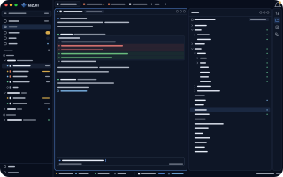

# lazuli

[English](README.md)

코딩 에이전트와 함께 일하기 위한 [Herdr 앱](https://herdr.dev) 레이아웃입니다. 에이전트와 그 풀 리퀘스트를 한 보드에
모아 보여 주고, GitHub 인박스, 할 일 목록, 예약 루틴, 줄마다 댓글을 달아 에이전트에게 보내는 리뷰 패널, 그리고
Markdown·HTML·PDF·그림을 미리 보는 파일 탭을 갖췄습니다. 이 모두를 손으로 쓴 모드 하나, `lazuli`가 그립니다.
Herdr, Node.js, GitHub CLI 말고는 필요한 것이 없습니다.



*레이아웃 도식 `layouts/lazuli.svg`: 사이드바, 탭과 벨, Files를 연 오른쪽 패널이 붙은 작업 화면, 액티비티 레일,
상태 표시줄. 내용은 지어낸 것입니다.*

lazuli는 [cockpit](https://github.com/quaresc/cockpit)에서 생성한 포크였던 `lstack-herdr`를 대신합니다. 그 레이아웃이
하던 일은 그대로 하되 cockpit에 기대지 않습니다. cockpit의 Runbook, Documents, Meetings, Monitor, Mail은 들어 있지
않습니다. 처음 한 번 실행되는 마이그레이션이 할 일 목록, 루틴, 사이드바 고정 항목, 대기 중인 프롬프트를 옮겨 옵니다
([lstack-herdr과 cockpit에서 옮겨 오기](#lstack-herdr과-cockpit에서-옮겨-오기)).

## 기능

**가운데 화면** (⌥⌘0~⌥⌘3)

- **Home.** 지금 손봐야 할 일을 맨 위에 두고, 에이전트를 단계별 보드(내 차례, 작업 중, 준비됨, 완료)에 풀 리퀘스트와
  CI 상태와 함께 보여 줍니다. Inbox·To-do·Routines 요약, 이번 주 사용 금액, 최근 GitHub 이벤트, 세션 복원이 대기 중이거나
  실패한 터미널도 여기 나옵니다. 기다리는 에이전트에게는 카드에서 바로 답할 수 있습니다(답장, 번호 선택, 미루기).
- **Inbox.** `gh`로 가져온 GitHub 소식입니다. 나에게 온 리뷰 요청(내 것 먼저, 그다음 내 팀, 봇은 따로), 내 풀 리퀘스트의
  CI 실패, 열려 있는 내 풀 리퀘스트, 최근 30일 동안 병합한 것이 나뉘어 나옵니다. 항목을 고르면 실패한 잡과 실패한 테스트,
  로그 끝부분, 해결되지 않은 리뷰 스레드, 바뀐 파일을 보여 줍니다. GitHub에서 열기, 병합, 실패한 잡 다시 실행, AI 계획,
  "새 에이전트로 시작", 에이전트에게 보내기를 할 수 있습니다.
- **To-do.** 추가, 수정, 체크, 순서 바꾸기, 삭제, 되돌리기를 모두 키보드로 합니다. 항목 안의 URL, `owner/repo#12`,
  `#12`는 눌러서 엽니다. 목록은 평범한 Markdown 파일 `data/lazuli/todo.md`입니다.
- **Routines.** 헤드리스 에이전트에게 줄 프롬프트나 셸 스크립트를 일정(`every 30m`, `daily 09:00`,
  `weekdays 9:00,17:30`, cron)이나 GitHub 이벤트(`on review`, `on ci-failed` 등)에 맞춰, 또는 손으로 실행합니다. 루틴마다
  다음·지난 실행, 출력, 비용, 기록이 보이고, 자기만의 git worktree에서 돌릴 수도 있습니다. 바로 실행, 중지, 일시 정지,
  수정, 삭제를 할 수 있습니다.

**사이드 패널** (⌘1~⌘4). 오른쪽 끝의 액티비티 레일은 가운데에 어떤 화면이 있든 늘 보입니다.

- **Review.** 포커스한 에이전트의 저장소를 diff로 봅니다. 범위는 커밋하지 않은 변경, 기준 브랜치와 비교한 이 브랜치,
  그리고 풀 리퀘스트 중에서 고릅니다. 줄마다 댓글을 달아 메시지 하나로 에이전트에게 보내거나, 변경을 단계별로 풀어 주는
  AI 워크스루를 읽습니다.
- **Files.** 포커스한 패널의 폴더를 git 표시와 함께 트리로 보여 줍니다. 새 파일, 새 폴더, 이름 바꾸기, 확인을 거치는
  삭제가 있고, 파일을 누르면 가운데 탭으로 열립니다.
- **Changes.** Herdr에 들어 있는 `changes` 모드입니다.
- **호출 트리.** 누가 누구를 시작했는지 실시간으로 보여 줍니다. OMP 세션마다 그 아래에 작업 하위 에이전트가, 터미널 아래에는
  그 터미널이 연 `hc` 자식 터미널이 붙습니다. 행을 열면 작업, 공유 컨텍스트, 결과가 나오고, "기록 열기"로 하위 에이전트의
  대화 기록을 읽기 전용으로 따라갑니다. 실행 보기는 한 번의 실행을 카드로 보여 주고, 따로 창을 띄워 볼 수도 있습니다.

**파일 탭.** 파일은 가운데의 Herdr 탭으로 열립니다. 한 번 누르면 스페이스마다 하나뿐인 미리보기 탭(이름이 `◦`로
시작)으로 열리고, 다음 파일도 그 탭을 다시 씁니다. 두 번 누르거나 처음 수정하면 탭이 고정됩니다. 이미 열린 파일은 그
탭으로 포커스가 옮겨 갑니다. 저장하지 않은 수정이 있으면 이름 앞에 `●`가 붙습니다. ⌘⇧V로 모드를 바꾸고, ⌘⇧O로 퍼지 검색해
파일을 엽니다.

| 파일 | 처음 모드 | 모드 |
|---|---|---|
| `.md`, `.markdown` | Split | Edit, Split, Preview |
| `.html`, `.htm` | Preview | Edit, Split, Preview |
| `.svg` | Split | Edit, Split, Preview |
| `.pdf` | Preview | Preview |
| PNG, JPEG, GIF, WebP | Preview(확대·축소 가능) | Preview |
| 그 밖의 텍스트 | Edit | Edit |
| 바이너리 | 정보 카드: 크기, 종류, "기본 앱으로 열기" | 없음 |

- Edit는 구문 강조가 되는 Herdr 기본 편집기이고, ⌘S로 저장합니다. 읽은 뒤 디스크에서 파일이 바뀌었다면 다시 불러올지
  덮어쓸지 묻습니다. 저장하지 않은 수정이 없으면, 에이전트가 파일을 고쳤을 때처럼 알아서 다시 불러옵니다.
- 저장하지 않은 수정은 1초마다 초안으로 남습니다. 파일을 다시 열면 복원할지 버릴지 고를 수 있습니다.
- Markdown 미리보기는 네이티브로 그리며 입력을 바로 따라갑니다. 제목, 할 일 항목이 있는 목록, 표, 인용, 구문 강조된 코드
  블록, 로컬 그림, 링크를 그립니다. "Chrome으로 보기"를 누르면 저장된 파일을 mermaid 다이어그램과 수식까지 그린 웹 페이지로
  엽니다.
- HTML 미리보기는 편집기 옆 터미널 패널에 그려지는 헤드리스 Chrome의 실제 페이지입니다. 누르고, 스크롤하고, 입력할 수
  있습니다. 저장된 파일을 보여 주고, 저장할 때마다 스크롤 위치를 지킨 채 다시 불러옵니다. 다른 사이트로 가는 링크는
  기본 브라우저에서 열립니다.
- PDF: 이어지는 스크롤, 단계별 확대(폭 맞춤, 50~200%), 페이지 이동, 목차, 결과를 강조하는 검색, 링크, "이 페이지 텍스트 복사".

**창 전체**

- **세션 복원.** Herdr가 터미널에 새 셸을 줄 때(재부팅, 로그아웃, 크래시) 그 터미널에서 돌던 Claude Code, Codex, OMP
  세션을 되살립니다. lazuli가 처음 실행할 때의 플래그 그대로 도구의 재개 명령을 입력합니다. 복원이 대기 중이거나 실패한
  터미널은 Home에 나오고, ⌥⌘R로 다시 시도합니다.
- **팔레트** (⇧⌘P). lazuli와 Herdr의 명령과 단축키, 레이아웃, 언어, 스페이스, 탭, 에이전트, 풀 리퀘스트, 할 일, 루틴,
  OMP·Claude Code·Codex의 지난 세션(Enter는 새 탭에서 재개, ⌘Enter는 포크), lazuli 설정을 찾습니다.
- **프롬프트 대기열** (⌥⌘Q). 에이전트가 일하는 동안 후속 지시를 적어 두었다가 하나씩, 또는 번호를 붙인 프롬프트 하나로
  모두 보냅니다. 오른쪽 가장자리의 서랍에 앞에 있는 에이전트의 대기열이 보입니다.
- **요약** (⌘R). 모든 에이전트를 단계별로 보여 주며, 무엇을 했는지 AI가 요약하고, 기다리는 질문에 그 자리에서 답하고,
  미루기·새 탭으로 포크하기를 할 수 있습니다. Time 탭에는 이번 주 티켓별 에이전트 작업 시간이 나옵니다.
- **이동.** ⌘J는 나를 기다리는 다음 에이전트, ⇧⌘J는 막힌 다음 에이전트, ⇧⌘U는 끝난 다음 에이전트로 갑니다. ⌘G와 ⌘L은
  포커스한 에이전트의 풀 리퀘스트와 티켓을 엽니다.
- **알림.** 에이전트가 막히거나 끝났을 때, 루틴이 끝났을 때, GitHub 이벤트가 생겼을 때 알립니다. Herdr가 앞에 있으면 창
  안에 띄우고, 뒤에 있으면 `terminal-notifier`로 macOS 알림을 보냅니다. 에이전트에 관한 알림을 누르면 그 에이전트로
  포커스가 갑니다. `terminal-notifier`가 없으면 창 안 토스트와 Dock 배지로 대신합니다.
- **한국어와 영어.** 처음에는 macOS 언어를 따릅니다(한국어면 한국어, 그 밖에는 영어). lazuli 설정이나 팔레트의 "언어"
  명령으로 바꾸면 바로 적용되고, AI가 쓰는 요약과 워크스루도 같은 언어를 씁니다.

## 필요한 것

| | |
|---|---|
| macOS | macOS 27, Apple 실리콘에서 만들고 써 왔습니다 |
| [Herdr 앱](https://herdr.dev) | 0.1.16과 함께 들어 있는 `tabs`, `changes` 모드. 설치 단계에서는 `PATH`에 `herdr-app`이 있어야 합니다 |
| [Node.js](https://nodejs.org) | `PATH`의 `node`, 22 이상(HTML 뷰어가 Node 내장 WebSocket을 씁니다). 26.13으로 만들었습니다 |
| [GitHub CLI](https://cli.github.com) | `gh auth login`으로 로그인한 `gh`: Inbox, 풀 리퀘스트, CI, Review의 PR 범위 |
| 에이전트 CLI | AI 기능(요약, 워크스루, AI 계획, 에이전트 루틴)용. 기본은 [OMP](https://omp.sh)(`omp`)이고, 설정에서 Claude Code(`claude`)나 Codex(`codex`)로 바꿀 수 있습니다 |

선택:

| | 없으면 |
|---|---|
| Google Chrome, Chromium, Microsoft Edge, Brave(이 순서로 찾습니다) | HTML 탭은 CSS와 스크립트 없이 그린 화면과 "브라우저로 열기"만 보여 줍니다 |
| Xcode 명령줄 도구(`xcode-select --install`), `swiftc`용 | PDF 렌더러를 빌드하지 못합니다. 그러면 Poppler의 `pdftocairo`(`brew install poppler`)로 그리는데 검색·링크·목차가 없고, Poppler도 없으면 "미리보기 앱으로 열기"만 남습니다 |
| [`terminal-notifier`](https://github.com/julienXX/terminal-notifier)(`brew install terminal-notifier`) | macOS 알림 대신 창 안 토스트와 Dock 배지를 씁니다 |
| `zstd`(`brew install zstd`) | 압축된 Codex 대화 기록(`.jsonl.zst`)을 사용 금액과 지난 세션에서 건너뜁니다 |
| OMP 확장 `lazuli-tree.ts`(설치 4단계) | 호출 트리가 OMP 자체 파일로 세션을 찾고, 상태에 추정 표시를 붙입니다 |

## 설치

아래 경로는 Herdr 앱 홈이 `~/.config/herdr-app`이라고 가정합니다(아니면 `HERDR_APP_HOME`). 이름은 바꿀 수 없습니다.
모드는 반드시 `mods/lazuli`에 있어야 합니다.

1. 파일을 받고, 덮어쓸 것이 없는지 확인합니다.

   ```sh
   git clone https://github.com/Lapis0875/herdr-lazuli.git
   cd herdr-lazuli
   APP=~/.config/herdr-app
   for p in mods/lazuli layouts/lazuli.json layouts/lazuli.svg themes/lazuli-light.json themes/lazuli-dark.json; do
     [ -e "$APP/$p" ] && echo "already there: $APP/$p"
   done
   ```

   무언가 출력되면 멈추세요. 이미 다른 사본이 설치되어 있습니다.

2. 모드, 레이아웃, 테마 두 개를 복사합니다.

   ```sh
   mkdir -p "$APP/themes"
   cp -R mods/lazuli "$APP/mods/"
   cp layouts/lazuli.json layouts/lazuli.svg "$APP/layouts/"
   cp themes/lazuli-light.json themes/lazuli-dark.json "$APP/themes/"
   ```

3. 단축키를 더합니다. 이 저장소의 `keys.json`(섹션 하나, `layout:lazuli`)을 내 파일에 합칩니다. `jq`로 하면서 백업을
   남기려면:

   ```sh
   cp "$APP/keys.json" "$APP/keys.json.before-lazuli"
   jq -s '.[0] + .[1]' "$APP/keys.json.before-lazuli" keys.json > "$APP/keys.json"
   ```

   Herdr는 한 번 고친 `keys.json`을 그때부터 사용자 파일로 다룹니다. 이후 Herdr 릴리스의 새 기본 단축키는 손으로 더해야
   합니다.

4. 선택: OMP에서 호출 트리를 실시간으로 보려면 확장을 링크하고, 예전 lstack-herdr 확장이 있다면 지웁니다.

   ```sh
   mkdir -p ~/.omp/agent/extensions
   rm -f ~/.omp/agent/extensions/lstack-herdr-tree.ts
   ln -s ~/.config/herdr-app/mods/lazuli/omp/lazuli-tree.ts ~/.omp/agent/extensions/
   ```

   그다음 omp를 다시 시작합니다.

5. 모드를 검사합니다.

   ```sh
   herdr-app check ~/.config/herdr-app/mods/lazuli
   ```

6. 레이아웃을 바꿉니다.

   ```sh
   herdr-app do layout.switch '{"name":"lazuli"}'
   ```

   `ctrl-shift-l`을 누르면 다른 레이아웃으로 돌아갑니다.

처음 시작할 때 lazuli는 마이그레이션을 한 번 실행하고(다음 절), `swiftc`가 있으면 백그라운드에서 PDF 렌더러를 빌드합니다.
macOS 알림을 쓰려면 lazuli 설정(사이드바 아래 → 설정)에서 "알림 허용"을 누르세요. macOS가 한 번 묻습니다.

## lstack-herdr과 cockpit에서 옮겨 오기

lazuli는 처음 시작할 때 cockpit과 lstack-herdr에서 쓸 수 있는 것을 복사합니다. 한 번만 실행됩니다. 모든 단계가 끝나면
Herdr 앱 홈의 `data/lazuli/migrated.json`을 쓰고, 옮긴 개수를 토스트 하나로 알려 줍니다. 실패한 단계가 있으면 표시 파일을
쓰지 않고 다음 시작 때 다시 실행합니다. 어느 단계든 여러 번 실행해도 안전합니다.

1. **할 일:** `~/.config/cockpit/todo.md`를 `data/lazuli/todo.md`로 복사합니다. lazuli 목록에 이미 무언가 있으면
   복사하지 않습니다.
2. **루틴:** `~/.config/cockpit/routines/*.md`(점으로 시작하는 파일 제외)를 `data/lazuli/routines/`로 복사합니다.
   lazuli에 이미 있는 루틴은 그대로 둡니다.
3. **사이드바 고정 항목:** `~/.config/cockpit/config.json`의 `.spaces` 중 Inbox, To-do, Routines 항목을 lazuli의 고정 앱으로
   가져옵니다. 이 파일에는 토큰이 들어 있어서 `.spaces` 값만 메모리로 읽고, 나머지는 남기지도 기록하지도 않습니다.
4. **프롬프트 대기열:** `~/.cache/cockpit/queue.json`에서 Herdr 앱 터미널의 대기열을 `data/lazuli/queue.json`으로
   복사합니다. lazuli 대기열에 이미 프롬프트가 있으면 복사하지 않습니다. 다른 프런트엔드의 대기열은 빠집니다.
5. **세션 복원 기록:** `lstack-herdr.resume` 라벨이 붙은 터미널을 모두 `lazuli.resume`으로 바꿉니다. 아직 불러오는 중인
   머신의 터미널은 준비되면 바꿉니다.
6. **캐시:** `~/.cache/lstack-herdr`를 지웁니다. 마이그레이션이 지우는 것은 이것뿐입니다.

복사한 파일은 cockpit 형식을 그대로 쓰므로 고치지 않아도 동작합니다. `~/.config/cockpit`과 `~/.cache/cockpit`은 바꾸거나
지우지 않으며, cockpit도 설치된 채로 남습니다.

cockpit 허브만 만들던 루틴 트리거(`on ticket`, `on assigned`, `on live`, `on release…`, `on alert`, `on error`)는
lazuli에서 쓸 수 없다고 표시됩니다. 셸 루틴의 환경 변수는 cockpit의 `COCKPIT_*`가 아니라 `LAZULI_ROUTINE`,
`LAZULI_ROUTINE_WHY`, `LAZULI_EVENT`, `LAZULI_EVENT_KEY`, `LAZULI_EVENT_KIND`입니다.

**lstack-herdr 지우기.** lazuli를 한 번 시작해서 마이그레이션이 끝난 뒤에 하세요.

```sh
APP=~/.config/herdr-app
rm -r "$APP/mods/lstack-herdr" "$APP/mods/lstack-herdr-cockpit" "$APP/layouts/lstack-herdr.json" "$APP/layouts/lstack-herdr.svg"
cp "$APP/keys.json" "$APP/keys.json.before-lstack-removal"
jq 'del(.["layout:lstack-herdr"])' "$APP/keys.json.before-lstack-removal" > "$APP/keys.json"
rm -f ~/.omp/agent/extensions/lstack-herdr-tree.ts
```

**cockpit 지우기**는 선택이며, lazuli가 대신 하지 않습니다. cockpit 0.38.5에는 Herdr 앱 쪽을 걷어 내는 명령이 있습니다.
`cockpit app uninstall`은 레이아웃, 모드, `cockpit.json`을 지우고 단축키는 남깁니다(`cockpit app` 도움말에 그렇게 나옵니다).
`keys.json`의 `layout:cockpit` 섹션은 손으로 지우세요. cockpit의 나머지(명령, 허브, 폴더)는
[cockpit README](https://github.com/quaresc/cockpit)를 따르세요.

## 단축키

`keys.json`의 `layout:lazuli` 섹션은 이 레이아웃이 보일 때만 적용됩니다. 사이드 패널 키는 그 탭이 이미 보이면 패널을
닫습니다.

| 키 | 동작 | 하는 일 |
|---|---|---|
| ⇧⌘P `cmd-shift-p` | `lazuli.palette` | 팔레트 |
| ⌥⌘0 `cmd-alt-0` | `lazuli.home` | Home, 또는 작업 화면으로 돌아가기 |
| ⌥⌘1 `cmd-alt-1` | `lazuli.go:inbox` | 가운데에 Inbox |
| ⌥⌘2 `cmd-alt-2` | `lazuli.go:todo` | 가운데에 To-do |
| ⌥⌘3 `cmd-alt-3` | `lazuli.go:routines` | 가운데에 Routines |
| ⌥⌘A `cmd-alt-a` | `lazuli.agent-view` | 작업 화면을 패널 보기와 포커스한 에이전트 보기 사이에서 전환 |
| ⌥⌘B `cmd-alt-b` | `lazuli.panel` | 사이드 패널 보이기·숨기기 |
| ⌘1 `cmd-1` | `lazuli.panel:review` | 사이드 패널 Review 탭 |
| ⌘2 `cmd-2` | `lazuli.panel:files` | 사이드 패널 Files 탭 |
| ⌘3 `cmd-3` | `lazuli.panel:changes` | 사이드 패널 Changes 탭 |
| ⌘4 `cmd-4` | `lazuli.panel:tree` | 사이드 패널 호출 트리 탭 |
| ⇧⌘V `cmd-shift-v` | `lazuli.file-mode` | 포커스한 파일 탭의 다음 모드: Edit → Split → Preview |
| ⇧⌘O `cmd-shift-o` | `lazuli.quickopen` | 포커스한 폴더 아래에서 빠르게 열기 |
| ⌘J `cmd-j` | `lazuli.next-waiting` | 나를 기다리는 다음 에이전트, 없으면 끝난 다음 에이전트 |
| ⇧⌘J `cmd-shift-j` | `lazuli.next:blocked` | 나를 기다리는 다음 에이전트 |
| ⇧⌘U `cmd-shift-u` | `lazuli.next:done` | 끝난 다음 에이전트 |
| ⌥⌘Q `cmd-alt-q` | `lazuli.queue` | 앞에 있는 에이전트의 프롬프트 대기열 |
| ⌥⌘R `cmd-alt-r` | `lazuli.resume` | 대기 중이거나 실패한 세션 복원을 모두 다시 시도 |
| ⌘R `cmd-r` | `lazuli.recap` | 요약 |
| ⌘G `cmd-g` | `lazuli.pr` | 포커스한 에이전트의 풀 리퀘스트 열기 |
| ⌘L `cmd-l` | `lazuli.ticket` | 포커스한 에이전트의 티켓 열기: PR 본문의 첫 트래커 링크, 없으면 브랜치 이름의 `KEY-123` |

lazuli 레이아웃이 보이는 동안 ⌘1~⌘4는 Herdr의 탭 선택 키를 대신합니다. ⌘5~⌘9는 그대로 탭을 선택합니다.

## 설정

lazuli 설정 화면(사이드바 아래 → 설정, 또는 팔레트)은 Herdr 앱 홈의 `data/lazuli/settings.json`에 씁니다. 바꾼 값은 바로
적용됩니다. 빠졌거나 잘못된 필드는 기본값을 쓰고, lazuli가 모르는 필드는 그대로 둡니다.

| 필드 | 기본값 | 뜻 |
|---|---|---|
| `language` | `"system"` | `"system"`, `"ko"`, `"en"`. `system`은 macOS 선호 언어의 첫 번째를 따릅니다 |
| `agent.command` | `["omp"]` | 요약, 워크스루, AI 계획, 에이전트 루틴에 쓰는 헤드리스 에이전트 명령이자, Inbox의 "새 에이전트로 시작"이 새 탭에서 여는 명령. 단어 안의 `{prompt}`가 프롬프트 자리입니다. 없으면 `omp`, `claude`, `codex`에 각자의 플래그를 붙입니다(`omp -p`, `claude -p … --output-format stream-json --verbose`, `codex exec --skip-git-repo-check`) |
| `agent.model` | 없음 | 모델을 받는 도구에 넘길 모델 |
| `notifications.system` | `true` | Herdr가 뒤에 있을 때 `terminal-notifier`로 보내는 macOS 알림 |
| `gh.org` | `[]` | 이 GitHub 조직의 풀 리퀘스트만 봅니다. 비우면 전부 |
| `gh.pollSec` | `120` | 창이 활성일 때 GitHub를 새로 읽는 간격(초, 30 이상). 뒤에 있을 때는 600초 |
| `routines.maxParallel` | `3` | 동시에 실행하는 루틴 수 |
| `pins` | `["inbox", "todo", "routines"]` | 사이드바에 고정한 앱과 그 순서 |
| `pdf.zoom` | `"fit"` | PDF를 열 때의 확대: `"fit"`, `50`, `75`, `100`, `125`, `150`, `200` |
| `editor` | `"code"` | "편집기에서 열기"에 쓰는 외부 편집기 명령(`code`, `cursor`, `zed` 등). 원격 폴더는 `--folder-uri vscode-remote://ssh-remote+<host><path>`로 엽니다 |

## 실행하고 읽고 쓰는 것

아래 목록은 소스에서 뽑았습니다. `mods/lazuli/`의 모든 `exec`·`hc` 호출, 그 호출이 실행하는 `sh -c` 스크립트 안의
프로그램(`[`, `printf`, `command` 같은 셸 내장 명령은 뺐습니다), `mods/lazuli/bin/`의 Node 스크립트가 띄우는 자식
프로세스입니다. 다른 머신의 스페이스에서는 파일과 저장소를 읽는 명령(Files 패널 목록, 파일 읽기, 빠르게 열기, `git`,
Review의 `gh`, 세션 찾기)이 그 머신에서 실행됩니다.

**프로그램**

- `gh`: Inbox 쿼리(`gh api graphql`), 리뷰 스레드(`gh api graphql`), 실패한 잡의 단계
  (`gh api repos/<repo>/actions/jobs/<id>`), 허용된 병합 방식(`gh api repos/<repo>`), PR 파일
  (`gh pr view <n> --json files`), CI 로그(`gh run list` 다음 `gh run view <id> --log-failed`), Review의 PR 범위
  (`gh pr view --json …`, `gh pr diff --color never`). GitHub에 쓰는 것은 두 가지이고, 버튼을 눌렀을 때만 실행합니다.
  병합(`gh pr merge <n> -R <repo> --squash|--merge|--rebase`)과 실패한 잡 다시 실행(`gh run rerun <id> --failed`)입니다.
- `git` 읽기: `rev-parse`, `config --get remote.origin.url`, `remote -v`(에이전트·스페이스·할 일 링크의 브랜치와 저장소),
  `status --porcelain=v1`(Files 표시), `diff`, `ls-files`, `symbolic-ref`, `merge-base`, `rev-list --count`(Review),
  `ls-files`(빠르게 열기). 쓰기는 `worktree: true`인 루틴에서만 합니다. 실행 전에
  `git worktree add -q -b auto/<slug>-<id>`, 실행 뒤나 Routines에서 남은 worktree를 지울 때 `git worktree remove`(강제하지
  않음)와 `git branch -d`, 브랜치에 자기 커밋이 없으면 `-D`.
- `node`: `bin/scan.mjs`(호출 트리, 대화 기록, 사용 금액, 지난 세션), `bin/run-agent.mjs`(헤드리스 실행, `hc run --bg`로
  분리해 시작), `bin/html-view.mjs`(파일 탭에 나눠 붙인 터미널 패널의 HTML 뷰어). `hc run`에 넘길 node 경로는
  `/usr/bin/which node`로 찾습니다.
- 헤드리스 실행에는 내 에이전트 명령(`agent.command`, 기본 `omp`)을, 셸 루틴에는 `/bin/sh -c <script>`를 쓰고, 둘 다
  `run-agent.mjs` 아래에서 돕니다. Herdr를 통해 새 탭에서 여는 것: 내 에이전트 명령("새 에이전트로 시작"), 지난 세션의
  재개·포크 명령(팔레트, 요약).
- `hc`: `send`(대기열 프롬프트, 리뷰 댓글, 답장, 재개 명령), `keys`(번호 선택 답), `read`(답장과 요약에 쓸 에이전트
  화면), `label`(복원 기록, 마이그레이션, HTML 뷰어 패널), `run --bg`(헤드리스 실행, PDF 렌더러), `kill`과 `rm`(이것들을
  멈추고 치우기), `machine ls --json`(외부 편집기에 넘길 원격 머신 호스트).
- PDF: `swiftc -O`(`bin/pdfd.swift`를 소스가 바뀔 때마다 한 번 빌드), 빌드한 `pdfd-<hash>`(`hc run --bg`로 시작), `mkdir`,
  `mv`, `rm`, `find … -delete`(30일 넘은 빌드). 대체 경로: Poppler의 `pdftocairo`, `pdfinfo`, `pdftotext`, `stat`(PDF의
  크기와 시각), 페이지 캐시를 300 MB 아래로 유지하는 `find`, `stat`, `rm`. "미리보기 앱으로 열기"에는 `open -a Preview`.
- Files 패널(`sh -c`): 새 폴더 `mkdir`, 이름 바꾸기 `mkdir`, `rmdir`, `mv`(`mv --version`이 되면 `mv -T`, 아니면 `perl`),
  `link`, `readlink`, `ln -s`, `rm`, 삭제 `/usr/bin/trash -s`(있을 때), 없으면 `rm`, 폴더 안 개수 세기 `find`, `head`, `wc`.
  목록과 새 파일은 셸만 씁니다. 그 밖에 `test -x /usr/bin/trash`, Windows 폴더 목록에는 `powershell`.
- 파일 탭: `test -w`(쓰기 가능 여부), `head -c`(1 MiB가 넘는 파일의 앞부분), `wc`, `tr`, `file -b`(정보 카드),
  `sips -g pixelWidth -g pixelHeight`(그림 크기), 그림을 이미지 캐시로 복사할 때 `wc`, `tr`, `shasum -a 1`, `cut`, `mkdir`,
  `cp`, `mv`, 빠르게 열기에 `git ls-files`나 `find`와 `head`, "기본 앱으로 열기"에 `open <file>`.
- 세션 복원과 요약(`sh -c`): `pgrep`, 그다음 `/proc/<pid>/fd`가 있으면 그 위의 `readlink`, 없으면 `lsof`와 `sed`, 이어서
  `grep`과 `head`(Codex나 OMP 프로세스가 열어 둔 세션), `sed`와 `head`(Claude Code 세션 파일), `find`, `head`, `wc`, `tr`
  (요약이 낡았는지 알기 위한 대화 기록 크기).
- 알림: `sh -c 'command -v terminal-notifier; command -v herdr-app'`, `terminal-notifier -diagnose`,
  `terminal-notifier -title lazuli … -activate dev.herdr.app`. 에이전트에 관한 알림이면
  `-execute "env HERDR_APP_HOME=… herdr-app do agent.focus --terminal <address>"`를 붙입니다.
- 그 밖에: `defaults read -g AppleLanguages`(시스템 언어), `open <url>`(링크, 풀 리퀘스트, 티켓), 내 편집기 명령(기본
  `code`, 안 되면 `open -a <app>`), `tail -c 65536`(실행 출력), `/bin/kill -0`과 `/bin/kill -KILL`(실행의 프로세스 그룹),
  `mkdir`, `dirname`, `mv`를 쓰는 `/bin/sh -c`(실행 파일 쓰기), `mkdir -p`, `test -d`, `rm -rf`(실행 파일),
  `find ~/.cache/lazuli/runs … -mtime +7 -exec rm -rf`(7일 넘은 헤드리스 실행), 그리고 마이그레이션에서 한 번
  `rm -rf ~/.cache/lstack-herdr`.
- Node 스크립트가 띄우는 것: `scan.mjs`는 `ps -o tty= -p <pid>`, `ps -t <tty> -o comm=`, `zstd -dc`를 실행합니다.
  `run-agent.mjs`는 실행할 명령을 자기 프로세스 그룹에서 돌리며 `PATH`에 `/opt/homebrew/bin`, `/usr/local/bin`,
  `~/.local/bin`, `~/.claude/local`을 더합니다. `html-view.mjs`는 `hc label`, `git rev-parse --show-toplevel`,
  `open <url>`, `pbpaste`, `pbcopy`를 실행하고 node로 `chrome-broker.mjs`를 띄웁니다. 브로커는 브라우저
  (`--headless=new --remote-debugging-port=0 --user-data-dir=~/.cache/lazuli/chrome-profile --no-first-run
  --no-default-browser-check`)와 `ps -o command= -p <pid>`를 실행합니다.

**읽는 것** (자기 폴더 밖)

- `~/.omp/agent/sessions/`, `~/.omp/agent/terminal-sessions/<tty>`, `~/.claude/projects/`, `~/.claude/sessions/<pid>.json`,
  `~/.codex/sessions/`: 호출 트리, 대화 기록, 사용 금액, 지난 세션, 세션 복원에 씁니다. 실행 중인 Codex나 확장 없이 도는
  OMP에서는 열어 둔 세션 파일의 이름만 읽습니다.
- 내가 연 파일과 폴더, Files 패널의 폴더, 스페이스와 에이전트의 저장소.
- 마이그레이션에서 한 번: `~/.config/cockpit/todo.md`, `~/.config/cockpit/routines/*.md`,
  `~/.config/cockpit/config.json`의 `.spaces` 값, `~/.cache/cockpit/queue.json`.

**쓰는 것**

- Herdr 앱 홈의 `data/lazuli/`: `settings.json`, `todo.md`, `queue.json`, `routines/<slug>.md`, `routines-state.json`
  (일정 상태와 루틴마다 최근 20번의 실행), `ledger.jsonl`(에이전트 작업 시간), `migrated.json`, `snap/<name>.json`(빠른
  시작과 herdr-relay에 쓰는 저장소별 스냅숏), `drafts/`(저장하지 않은 수정), `cache/img/`(미리보기용 그림, 하나에 20 MB,
  모두 합쳐 200 MB까지), `cache/pdf/`(그린 페이지, 300 MB까지), `cache/walkthrough/`(끝난 워크스루), `tmp/`(제자리로 옮기기 전의 텍스트 파일).
- `~/.cache/lazuli/`: `scan-cache.json`, `run-cache.json`, `usage-cache.json`, `sessions-index.json`(대화 기록 리더의
  캐시), `recaps/`, `routines/<slug>/<id>.*`와 `runs/<id>.*`(실행 파일: 명령, pid, 출력, 종료 상태), `bin/pdfd-<hash>`,
  `pdfd-<home>.json`(Herdr 앱 홈마다 하나), `chrome.json`(둘 다 0600), `broker.lock`, `chrome-profile/`, `chrome.log`, `broker.log`.
- `~/.herdr/worktrees/<repo>/auto/<slug>-<id>`: 루틴의 worktree. 실행이 아무것도 남기지 않았으면 실행 뒤에 지웁니다.
- Herdr 공유 상태(`shared.json`): `lazuli.*` 키. 열린 파일 탭 목록도 여기 있습니다.
- 터미널 라벨: `lazuli.resume`(복원할 내용), `lazuli.run`, `lazuli.sidecar`, `lazuli.view`.
- 내가 저장하고, 만들고, 이름을 바꾸고, 지운 것. `/usr/bin/trash`가 있으면 삭제한 것은 휴지통으로 갑니다.
- OMP 확장은 OMP가 도는 터미널에 OSC 7501 기록을 씁니다.

**네트워크**

- `gh`는 내 `gh` 로그인으로 GitHub와 통신하고, 에이전트 CLI는 각자의 제공자와 통신합니다.
- HTML 뷰어의 헤드리스 브라우저는 `~/.cache/lazuli/chrome-profile`의 별도 프로필로, 페이지가 불러오는 것을 그대로
  불러옵니다. Markdown을 그린 페이지("Chrome으로 보기")는 다이어그램이나 수식이 있을 때만 `cdn.jsdelivr.net`에서
  mermaid 12.3.0과 KaTeX 0.19.1을 하위 리소스 무결성(SRI)으로 고정해 불러옵니다.
- 루프백(`127.0.0.1`, 임의 포트)만 쓰는 것: 뷰어의 파일 서버, 브라우저의 DevTools 포트, Chrome 브로커의 임대 포트, PDF
  렌더러. PDF 렌더러는 0600 권한의 discovery 파일에 든 토큰을 가진 클라이언트에만 답합니다. 모드 자체가 쓰는 네트워크는
  PDF 렌더러와의 연결뿐입니다.
- 링크는 기본 브라우저에서 열립니다.

## 휴대폰과 태블릿에서: herdr-relay

[herdr-relay](https://github.com/Lapis0875/herdr-relay)는 Herdr 창을 휴대폰과 태블릿으로 옮겨 줍니다. Mac에서 Herdr 옆에
돌면서 같은 레이아웃과 모드를 그리고, Tailscale 네트워크를 거쳐 홈 화면에 추가하는 웹 앱으로 보냅니다. 버전은 0.1.0이고,
macOS와 Tailscale만 지원하며, [Deno](https://deno.com) 2.9 이상이 필요하고, Herdr 0.1.14~0.1.16에서 테스트했습니다.

기기에서 lazuli는 읽기 전용입니다. 모드가 기기에서 무엇을 할 수 있는지는 herdr-relay 정책 프로필이 정하는데, 어떤
프로필로도 `gh`, `omp`, `sh` 실행, 파일 저장, 탭 열기는 허용할 수 없습니다(herdr-relay의 `docs/PROFILES.md` §1·§6,
`docs/POLICY.md` §2.4). 이 저장소는 `relay/lazuli.profile.json` 프로필을 함께 제공합니다.

| 기기에서 | 결과 |
|---|---|
| Home, Inbox, To-do, Routines, 사이드바, 상태 표시줄 | Mac이 `data/lazuli/` 아래에 쓰는 스냅숏으로 그립니다 |
| git 표시, 브랜치 | 동작(읽기 전용 `git`) |
| 호출 트리, 사용 금액 | 동작. `scan.mjs`는 herdr-relay 샌드박스 안에서 홈 폴더 읽기, `~/.cache/lazuli` 쓰기, `ps`만 허락받고 돕니다 |
| 이미 열려 있는 Markdown 파일 탭 | 미리보기 |
| 링크 | 기기에서 열립니다 |
| `gh`, 에이전트 실행, HTML 뷰어, 에이전트에게 보내기 | 거부 |
| 저장, 할 일 목록 수정, 파일 탭 열기 | 거부 |
| Markdown 속 그림, PDF 페이지 | 그리지 않음 |

설치 방법:

1. herdr-relay README대로 설치한 뒤 미러 모드를 설치합니다(`herdr-relay install-mod`). 이 명령이 출력하는 항목을
   `~/.config/herdr-app/layouts/lazuli.json` 루트의 `floating` 목록에서 `queue` 다음에 넣고,
   `herdr-app check ~/.config/herdr-app/mods/herdr-relay-mirror`로 검사합니다.
2. 프로필을 설치합니다. herdr-relay는 권한이 0600인 일반 파일만 받습니다.

   ```sh
   mkdir -p ~/.herdr/herdr-relay/profiles
   cp relay/lazuli.profile.json ~/.herdr/herdr-relay/profiles/lazuli.json
   chmod 600 ~/.herdr/herdr-relay/profiles/lazuli.json
   ```

3. 브리지를 다시 시작합니다. 프로필은 시작할 때 읽고, 불러오거나 무시한 사용자 프로필을 로그에 남깁니다. 브리지를 켜지 않고
   프로필을 검사하는 방법은 herdr-relay의 `docs/PROFILES.md` §9에 있습니다.

## 한계

- **macOS 전용.** PDF 렌더러는 PDFKit이고, 알림·그림 크기·시스템 언어도 macOS 프로그램을 씁니다. Herdr 0.1.16에서
  만들었고 다른 버전은 테스트하지 않았습니다.
- **Herdr 앱 홈마다 한 벌**, `mods/lazuli`에만 둘 수 있습니다. 스크립트 경로와 명령이 이 이름을 씁니다.
- **작업 화면이 에이전트 하나를 크게 보일 때(⌥⌘A)의 탭.** Herdr가 그 에이전트의 창에 포커스를 붙잡아 두어, Herdr 탭
  줄에서 에이전트가 없는 탭을 고르면 그 에이전트의 탭으로 되돌아갑니다. 사이드바는 먼저 작업 화면을 탭 보기로 돌리므로
  그런 탭은 사이드바에서 고르거나, 탭 줄을 쓰기 전에 ⌥⌘A를 누릅니다.
- **GitHub만.** Inbox, 풀 리퀘스트, CI는 `gh`에서 옵니다. Linear나 Jira 인박스는 없습니다. ⌘L은 PR 본문이나 브랜치
  이름에서만 티켓을 찾습니다.
- **루틴은 Herdr가 켜져 있을 때만 돕니다.** 다시 시작했을 때 놓친 실행이 있으면, 마지막으로 놓친 시각이 `catch-up`
  범위(기본 12시간) 안일 때 한 번 실행하고, 그보다 늦으면 실행 대신 "놓침" 기록을 남깁니다. 이벤트 트리거는 GitHub
  것뿐입니다: `review`, `approved`, `changes`, `opened`, `merged`, `ci-failed`, `ci-passed`, `any`.
- **사용 금액.** OMP는 달러를 기록합니다. Claude Code와 Codex는 토큰만 기록하므로 손으로 고치는 `core/pricing.js`의 가격표로
  계산합니다. 표에 없는 모델은 가격 없음 표시와 함께 토큰으로 보여 주고, 긴 컨텍스트 할증은 계산하지 않습니다.
- **호출 트리는 OMP만 읽습니다.** Claude Code와 Codex의 하위 에이전트는 나오지 않습니다. OMP 확장이 없으면 상태를 대화
  기록에서 추정하고 그렇게 표시합니다. Herdr는 터미널마다 기록을 255개까지 두므로, 확장은 하위 에이전트 보고 64개마다 세션
  기록을 다시 보냅니다.
- **세션 복원**은 각 도구의 플래그를 다음 버전 기준으로 읽습니다: Claude Code 2.1.311, Codex 0.167.0, OMP 18.20.3. Herdr가
  패널로 유지하는 터미널만 대상입니다.
- **편집.** 400,000자가 넘는 파일은 잘린 채 읽기 전용으로 열립니다. NUL이 든 파일, 쓰기 권한이 없는 파일, 다른 머신
  스페이스의 모든 파일도 읽기 전용입니다.
- **원격 스페이스.** Markdown과 텍스트만 됩니다. Markdown은 미리보기가 되고, HTML과 SVG는 소스만, PDF와 그림은 정보
  카드만 보입니다.
- **HTML 미리보기**는 저장된 파일만 보여 주고 저장하지 않은 수정은 보여 주지 않으며, 네 브라우저 중 하나가 있어야
  합니다. **Markdown 미리보기**에는 기울임꼴이 없고(Pretendard에 이탤릭 서체가 없어 강조는 굵기나 색으로 합니다)
  다이어그램과 수식도 없습니다. 이 둘은 "Chrome으로 보기"에서만 보이고, CDN 스크립트를 받으려면 네트워크가 필요합니다.
- **PDF.** 드래그로 고를 수 없고 대신 "이 페이지 텍스트 복사"가 있습니다. `pdftocairo` 대체 경로에는 검색, 링크, 목차가
  없습니다.
- **Files 패널:** 폴더마다 500개, 모두 합쳐 5,000개까지 보여 줍니다. `/usr/bin/trash`가 없으면 삭제는 되돌릴 수 없고,
  확인 창에도 그렇게 나옵니다. **빠르게 열기**는 파일을 20,000개까지(git 밖에서는 `find`로 깊이 6까지) 모아 가장 잘 맞는
  50개를 보여 줍니다.
- **herdr-relay 기기**에서는 읽기 전용입니다(위 참고).

## 제거

1. 실행 중인 루틴을 멈추고, `ctrl-shift-l`로 다른 레이아웃으로 바꾼 뒤 5분 기다립니다. PDF 렌더러와 공유 Chrome은 마지막으로
   쓰고 5분 뒤에 종료됩니다.
2. 파일을 지웁니다.

   ```sh
   APP=~/.config/herdr-app
   rm -r "$APP/mods/lazuli" "$APP/layouts/lazuli.json" "$APP/layouts/lazuli.svg"
   rm "$APP/themes/lazuli-light.json" "$APP/themes/lazuli-dark.json"
   rm -rf ~/.cache/lazuli
   rm -f ~/.omp/agent/extensions/lazuli-tree.ts ~/.herdr/herdr-relay/profiles/lazuli.json
   ```

3. `keys.json`의 `layout:lazuli` 섹션을 손으로, 또는 `jq 'del(.["layout:lazuli"])'`로 지웁니다.
4. Herdr 앱 홈의 `data/lazuli/`에는 할 일 목록, 루틴, 대기열, 설정이 있습니다. 더 필요 없으면
   `rm -r ~/.config/herdr-app/data/lazuli`로 지우세요. 루틴이 남겨 둔 worktree는 `git worktree remove`로 지울 때까지
   `~/.herdr/worktrees/` 아래에 남습니다.

터미널의 `lazuli.resume` 라벨은 터미널을 닫을 때까지 남지만, lazuli가 없으면 아무도 읽지 않습니다.

## 개발

lazuli의 구조와 작업 방법(구조, 테스트, 화면 미리보기, 문구와 아이콘 추가)은 [RECIPE.md](RECIPE.md)(영어)에 있습니다.
설계 결정은 [docs/DESIGN.md](docs/DESIGN.md), 아키텍처는 [docs/ARCHITECTURE.md](docs/ARCHITECTURE.md)에 있습니다.

## 크레딧

- quaresc의 [cockpit](https://github.com/quaresc/cockpit): 리뷰 diff, 워크스루, GitHub 쿼리, 할 일·대기열·루틴 형식을
  lazuli로 옮겨 왔습니다. lazuli의 전신인 lstack-herdr도 cockpit 위에 만들었습니다.
- Devrim Mazlum의 [herdr-walkthrough](https://github.com/dmazlum/herdr-walkthrough): cockpit의 워크스루를 거쳐 들어왔습니다.
- [Herdr 앱](https://herdr.dev): Files 패널 트리의 출처인 `files` 모드와 사이드바 글리프.
- [Lucide](https://github.com/lucide-icons/lucide)와 Feather: 아이콘.
- [marked](https://github.com/markedjs/marked): Markdown 파서.
- 길형진의 [Pretendard](https://github.com/orioncactus/pretendard): UI 글꼴.

## 라이선스

MIT © 2026 Lapis0875, [LICENSE](LICENSE)를 보세요. 다른 프로젝트에서 온 부분은 각자의 라이선스를 따릅니다.
[THIRD_PARTY_NOTICES.md](THIRD_PARTY_NOTICES.md)에 정리했고, Apache License 2.0 전문은
[LICENSES/Apache-2.0.txt](LICENSES/Apache-2.0.txt), Lucide 라이선스는 [LICENSES/Lucide.txt](LICENSES/Lucide.txt)에
있습니다. Pretendard 라이선스는 글꼴 옆에, marked 라이선스는 `mods/lazuli/vendor/`에 있습니다.
