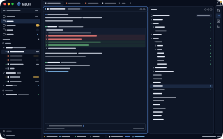

# lazuli

[한국어](README.ko.md)

A [Herdr app](https://herdr.dev) layout for working with coding agents: your agents and their pull requests on one
board, a GitHub inbox, a to-do list and scheduled routines, a review panel that sends line comments to an agent, files
opened as tabs with Markdown, HTML, PDF and picture previews, and an Assistant screen that chats with
[Hermes Agent](https://hermes-agent.nousresearch.com) in a folder you choose. One hand-written mod, `lazuli`, draws all
of it; it needs nothing besides Herdr, Node.js and the GitHub CLI, plus Hermes Agent for the Assistant.



*The layout's schematic, `layouts/lazuli.svg`: sidebar, tabs and bell, the work view with the right panel on Files,
the activity rail, the status bar. Made-up content.*

lazuli replaces `lstack-herdr`, which was a generated fork of [cockpit](https://github.com/quaresc/cockpit). It keeps
what that layout did and drops its cockpit dependency; cockpit's Runbook, Documents, Meetings, Monitor and Mail are not
part of it. A one-time migration brings your to-do list, routines, sidebar pins and queued prompts over
([Moving from lstack-herdr and cockpit](#moving-from-lstack-herdr-and-cockpit)).

## Features

**Center views** (⌥⌘0 to ⌥⌘4):

- **Home.** The next thing that needs you, then your agents on a board by stage (needs you, working, ready, done)
  with their pull request and CI state, summaries of Inbox, To-do and Routines, this week's spend, recent GitHub
  events, and the terminals whose session restore is pending or failed. Answer a waiting agent from its card (reply,
  pick a numbered choice, snooze).
- **Inbox.** GitHub through `gh`: review requests (yours, then your teams'; bots apart), CI failures of your pull
  requests, your other open pull requests, and what you merged in the last 30 days. A row's details show the failing
  job with its failed tests and log tail, the unresolved review threads and the changed files. Actions: open on
  GitHub, merge, rerun failed jobs, plan with AI, start an agent on it, send it to an agent.
- **To-do.** Add, edit, check, reorder, delete and undo, all from the keyboard. A URL, `owner/repo#12` or `#12` in an
  item opens. The list is a plain Markdown file, `data/lazuli/todo.md`.
- **Routines.** Prompts for a headless agent or shell scripts that run on a schedule (`every 30m`, `daily 09:00`,
  `weekdays 9:00,17:30`, cron), on a GitHub event (`on review`, `on ci-failed`, …) or by hand. Each shows its next and
  last run, output, cost and history; it can run in its own git worktree. Run now, stop, pause, edit, delete.
- **Assistant** (비서). Chats with Hermes Agent in one folder: your chats on the left, grouped by Hermes profile; the
  chat in the middle, with replies streaming as Markdown, tool calls as cards (file edits as a diff), approval cards,
  Stop, steering a running reply with Enter and queueing the next message with ⌥Enter or ⌘Enter; the folder's files
  and the chat's model, context, tokens and cost on the right ([Assistant](#assistant)).

**Side panel** (⌘1 to ⌘4), with an activity rail at the right edge that stays visible on every center view:

- **Review.** The focused agent's repository as a diff: uncommitted changes, the branch against its base, or its pull
  request. Comment on lines and send every comment to the agent as one message, or read an AI walkthrough of the
  changes in steps.
- **Files.** The focused pane's folder as a tree with git marks; new file, new folder, rename, and delete behind a
  confirm. A click opens the file in a center tab.
- **Changes.** Herdr's own `changes` mod.
- **Call tree.** Who started whom: each OMP session with its task subagents nested under it, and `hc` child terminals
  under the terminal that started them, live. A row opens its task, shared context and result; "Open Transcript"
  follows a subagent's transcript read-only. The run view shows one run as cards, also in a window of its own.

**File tabs.** A file opens as a Herdr tab in the center. A single click opens the space's preview tab (its name
starts with `◦`), reused for the next file; a double click or your first edit pins it. A file already open gets its tab
focused. `●` marks unsaved edits. ⌘⇧V cycles the modes, ⌘⇧O opens a file by fuzzy search.

| File | Opens in | Modes |
|---|---|---|
| `.md`, `.markdown` | Split | Edit, Split, Preview |
| `.html`, `.htm` | Preview | Edit, Split, Preview |
| `.svg` | Split | Edit, Split, Preview |
| `.pdf` | Preview | Preview |
| PNG, JPEG, GIF, WebP | Preview, with zoom | Preview |
| other text | Edit | Edit |
| binary | an info card: size, type, "Open in default app" | none |

- Edit is Herdr's native editor with syntax highlighting; ⌘S saves. A file changed on disk since it was read asks
  whether to reload or overwrite; with no unsaved edits it reloads by itself, for example when an agent rewrites it.
- Unsaved edits are kept as a draft every second. Reopening the file offers to restore or discard them.
- Markdown preview is drawn natively and follows your typing: headings, lists with task items, tables, quotes, code
  blocks highlighted, local pictures, links. "View in Chrome" opens the saved file as a web page with mermaid
  diagrams and math.
- HTML preview is a live page in headless Chrome, drawn in a terminal pane beside the editor: click, scroll and type
  into it. It shows the saved file and reloads after each save, keeping the scroll position. Links to other sites open
  in your browser.
- PDF: continuous scroll, zoom steps (fit width, 50 to 200%), page jump, outline, search with highlighted hits, links,
  "Copy page text".

**Across the window:**

- **Session restore.** When Herdr gives a terminal a fresh shell (a reboot, a logout, a crash), the Claude Code, Codex
  or OMP session that ran in it comes back: lazuli types the tool's resume command, with its original flags. Home
  lists the terminals whose restore is pending or failed; ⌥⌘R tries them again.
- **Palette** (⇧⌘P). lazuli's and Herdr's commands with their keys, layouts, the language, spaces, tabs, agents, pull
  requests, to-dos, routines, the Assistant's chats, and past sessions of OMP, Claude Code and Codex (Enter resumes one
  in a new tab, ⌘Enter forks it), and lazuli's settings.
- **Prompt queue** (⌥⌘Q). Write follow-ups while an agent works; send one, or all of them as one numbered prompt. A
  drawer on the right edge shows what waits for the agent in front.
- **Recap** (⌘R). Every agent by stage with an AI recap of what it did, the question it waits on answered in place,
  snooze, fork into a new tab, and a Time tab with this week's agent time per ticket.
- **Jumps.** ⌘J goes to the next agent waiting for you, ⇧⌘J the next blocked one, ⇧⌘U the next finished one; ⌘G and
  ⌘L open the focused agent's pull request and ticket.
- **Notifications.** An agent turning blocked or done, a routine ending, GitHub events, and the Assistant asking for an
  approval or finishing a reply. While Herdr is in front they show inside the window. In the background they become
  macOS notifications through `terminal-notifier`; clicking one about an agent focuses that agent, one about an
  Assistant chat opens it. Without `terminal-notifier`, lazuli falls back to the in-window toast and a Dock badge.
- **Korean and English.** The macOS language decides at first (Korean → Korean, anything else → English). Switch in
  lazuli's settings or with the palette command "Language"; it applies at once, and AI-written recaps and walkthroughs
  follow it.

## Requirements

| | |
|---|---|
| macOS | built and used on macOS 27, Apple silicon |
| [Herdr app](https://herdr.dev) | 0.1.16, with its shipped `tabs` and `changes` mods; `herdr-app` on `PATH` for the install steps |
| [Node.js](https://nodejs.org) | `node` on `PATH`, 22 or newer (the HTML viewer uses Node's built-in WebSocket); built with 26.13 |
| [GitHub CLI](https://cli.github.com) | `gh`, signed in with `gh auth login`: Inbox, pull requests, CI, Review's PR scope |
| An agent CLI | for the AI features (recap, walkthrough, AI plan, agent routines): [OMP](https://omp.sh) (`omp`) by default; Claude Code (`claude`) or Codex (`codex`) through the settings |

Optional:

| | Without it |
|---|---|
| Google Chrome, Chromium, Microsoft Edge or Brave (looked up in that order) | HTML tabs show a plain render without CSS or scripts, plus "Open in browser" |
| Xcode command line tools (`xcode-select --install`), for `swiftc` | the PDF renderer cannot be built: PDFs render with Poppler's `pdftocairo` (`brew install poppler`), without search, links or outline; without Poppler too, "Open in Preview" |
| [`terminal-notifier`](https://github.com/julienXX/terminal-notifier) (`brew install terminal-notifier`) | in-window toasts and a Dock badge instead of macOS notifications |
| `zstd` (`brew install zstd`) | compressed Codex transcripts (`.jsonl.zst`) are skipped in spend and past sessions |
| the OMP extension `lazuli-tree.ts` (install step 4) | the call tree still finds OMP sessions from OMP's own files, and marks their statuses as estimated |
| [Hermes Agent](https://hermes-agent.nousresearch.com) (`hermes`), tested with 0.17.0 | the Assistant screen shows how to install it and has nothing else to show |

## Install

Paths below assume the Herdr app's home is `~/.config/herdr-app` (`HERDR_APP_HOME` otherwise). The names are fixed: the
mod must be `mods/lazuli`.

1. Get the files and make sure nothing is overwritten:

   ```sh
   git clone https://github.com/Lapis0875/herdr-lazuli.git
   cd herdr-lazuli
   APP=~/.config/herdr-app
   for p in mods/lazuli layouts/lazuli.json layouts/lazuli.svg themes/lazuli-light.json themes/lazuli-dark.json; do
     [ -e "$APP/$p" ] && echo "already there: $APP/$p"
   done
   ```

   If that prints anything, stop: another copy is installed.

2. Copy the mod, the layout and its two themes:

   ```sh
   mkdir -p "$APP/themes"
   cp -R mods/lazuli "$APP/mods/"
   cp layouts/lazuli.json layouts/lazuli.svg "$APP/layouts/"
   cp themes/lazuli-light.json themes/lazuli-dark.json "$APP/themes/"
   ```

3. Add the keys: merge this repository's `keys.json` (one section, `layout:lazuli`) into yours. With `jq`, keeping a
   backup:

   ```sh
   cp "$APP/keys.json" "$APP/keys.json.before-lazuli"
   jq -s '.[0] + .[1]' "$APP/keys.json.before-lazuli" keys.json > "$APP/keys.json"
   ```

   Herdr treats an edited `keys.json` as yours from then on: new default shortcuts in later Herdr releases have to be
   added by hand.

4. Optional, for the live call tree in OMP: link the extension and remove lstack-herdr's, if you had it.

   ```sh
   mkdir -p ~/.omp/agent/extensions
   rm -f ~/.omp/agent/extensions/lstack-herdr-tree.ts
   ln -s ~/.config/herdr-app/mods/lazuli/omp/lazuli-tree.ts ~/.omp/agent/extensions/
   ```

   Then restart omp.

5. Check the mod:

   ```sh
   herdr-app check ~/.config/herdr-app/mods/lazuli
   ```

6. Switch to the layout:

   ```sh
   herdr-app do layout.switch '{"name":"lazuli"}'
   ```

   `ctrl-shift-l` cycles back through your other layouts.

On its first start lazuli runs the migration once (next section) and, if `swiftc` is there, builds its PDF renderer in
the background. For macOS notifications, open lazuli's settings (sidebar footer → Settings) and press "Allow
notifications": macOS asks once.

## Moving from lstack-herdr and cockpit

On its first start, lazuli copies what it can use from cockpit and lstack-herdr. It runs once: when every step is
done it writes `data/lazuli/migrated.json` in the Herdr app's home and shows one toast with the counts. A step that
fails writes no marker, and the next start runs it again; every step is safe to repeat.

1. **To-do:** `~/.config/cockpit/todo.md` is copied to `data/lazuli/todo.md`, unless lazuli's list already holds
   anything.
2. **Routines:** `~/.config/cockpit/routines/*.md` (not dot files) are copied to `data/lazuli/routines/`; a routine
   lazuli already has is kept.
3. **Sidebar pins:** the Inbox, To-do and Routines entries of `.spaces` in `~/.config/cockpit/config.json` become
   lazuli's pinned apps. That file holds tokens: only the `.spaces` value is read into memory, and nothing else of it
   is kept or logged.
4. **Prompt queue:** the queues of Herdr app terminals in `~/.cache/cockpit/queue.json` are copied to
   `data/lazuli/queue.json`, unless lazuli's queue already holds prompts. Other frontends' queues are left out.
5. **Session restore records:** every terminal labelled `lstack-herdr.resume` is relabelled `lazuli.resume`. Terminals
   on a machine that is still loading are relabelled once it is ready.
6. **Cache:** `~/.cache/lstack-herdr` is deleted. This is the only thing the migration deletes.

The files lazuli copies keep cockpit's formats, so they work unchanged. Nothing in `~/.config/cockpit` or
`~/.cache/cockpit` is changed or removed, and cockpit stays installed.

Routine triggers that only cockpit's hub produced (`on ticket`, `on assigned`, `on live`, `on release…`, `on alert`,
`on error`) show as not available in lazuli. Shell routines get `LAZULI_ROUTINE`, `LAZULI_ROUTINE_WHY`,
`LAZULI_EVENT`, `LAZULI_EVENT_KEY` and `LAZULI_EVENT_KIND` in their environment, not cockpit's `COCKPIT_*` names.

**Removing lstack-herdr**, after lazuli has started once (so the migration has run):

```sh
APP=~/.config/herdr-app
rm -r "$APP/mods/lstack-herdr" "$APP/mods/lstack-herdr-cockpit" "$APP/layouts/lstack-herdr.json" "$APP/layouts/lstack-herdr.svg"
cp "$APP/keys.json" "$APP/keys.json.before-lstack-removal"
jq 'del(.["layout:lstack-herdr"])' "$APP/keys.json.before-lstack-removal" > "$APP/keys.json"
rm -f ~/.omp/agent/extensions/lstack-herdr-tree.ts
```

**Removing cockpit** is optional; lazuli never does it. cockpit 0.38.5's own command takes its Herdr app parts out:
`cockpit app uninstall` removes its layout, its mod and `cockpit.json`, and leaves the keys (its `cockpit app` help
says so); remove the `layout:cockpit` section of `keys.json` by hand. For the rest of cockpit (its command, hub and
folders), follow [cockpit's README](https://github.com/quaresc/cockpit).

## Keys

The section `layout:lazuli` in `keys.json` applies only while this layout shows. A side panel key pressed while its
tab already shows closes the panel.

| Key | Action | What it does |
|---|---|---|
| ⇧⌘P `cmd-shift-p` | `lazuli.palette` | the palette |
| ⌥⌘0 `cmd-alt-0` | `lazuli.home` | Home, or back to the work view |
| ⌥⌘1 `cmd-alt-1` | `lazuli.go:inbox` | Inbox in the center |
| ⌥⌘2 `cmd-alt-2` | `lazuli.go:todo` | To-do in the center |
| ⌥⌘3 `cmd-alt-3` | `lazuli.go:routines` | Routines in the center |
| ⌥⌘4 `cmd-alt-4` | `lazuli.go:assistant` | the Assistant in the center |
| ⌥⌘A `cmd-alt-a` | `lazuli.agent-view` | the work view switches between the panes and the focused agent |
| ⌥⌘B `cmd-alt-b` | `lazuli.panel` | shows or hides the side panel |
| ⌘1 `cmd-1` | `lazuli.panel:review` | side panel tab Review |
| ⌘2 `cmd-2` | `lazuli.panel:files` | side panel tab Files |
| ⌘3 `cmd-3` | `lazuli.panel:changes` | side panel tab Changes |
| ⌘4 `cmd-4` | `lazuli.panel:tree` | side panel tab call tree |
| ⇧⌘V `cmd-shift-v` | `lazuli.file-mode` | the focused file tab's next mode: Edit → Split → Preview |
| ⇧⌘O `cmd-shift-o` | `lazuli.quickopen` | quick open under the focused folder |
| ⌘J `cmd-j` | `lazuli.next-waiting` | the next agent that needs you, else the next finished one |
| ⇧⌘J `cmd-shift-j` | `lazuli.next:blocked` | the next agent that needs you |
| ⇧⌘U `cmd-shift-u` | `lazuli.next:done` | the next finished agent |
| ⌥⌘Q `cmd-alt-q` | `lazuli.queue` | the prompt queue of the agent in front |
| ⌥⌘R `cmd-alt-r` | `lazuli.resume` | retries every pending or failed session restore |
| ⌘R `cmd-r` | `lazuli.recap` | the recap |
| ⌘G `cmd-g` | `lazuli.pr` | opens the focused agent's pull request |
| ⌘L `cmd-l` | `lazuli.ticket` | opens the focused agent's ticket: the first tracker link in the PR body, else a `KEY-123` in the branch name |

⌘1–⌘4 replace Herdr's tab selection keys while the lazuli layout is shown; ⌘5–⌘9 still select tabs. Updating from a
lazuli without the Assistant: copy `layouts/lazuli.json` again (install step 2) and merge `keys.json` again (step 3)
for its screen and ⌥⌘4.

## Settings

lazuli's settings view (sidebar footer → Settings, or the palette) writes `data/lazuli/settings.json` in the Herdr
app's home. Changes apply at once. A field that is missing or invalid takes its default; fields lazuli does not know
are kept.

| Field | Default | Meaning |
|---|---|---|
| `language` | `"system"` | `"system"`, `"ko"` or `"en"`; `system` follows the first language in macOS's preferred languages |
| `agent.command` | `["omp"]` | the headless agent's command for recaps, walkthroughs, AI plans and agent routines, and the command "Start an agent on it" opens in a new tab. `{prompt}` in a word marks where the prompt goes; without it, `omp`, `claude` and `codex` get their own flags (`omp -p`, `claude -p … --output-format stream-json --verbose`, `codex exec --skip-git-repo-check`) |
| `agent.model` | none | a model for tools that take it |
| `notifications.system` | `true` | macOS notifications through `terminal-notifier` while Herdr is in the background |
| `gh.org` | `[]` | only pull requests in these GitHub organizations; empty means all |
| `gh.pollSec` | `120` | seconds between GitHub refreshes while the window is active (at least 30); in the background it is 600 |
| `routines.maxParallel` | `3` | routines running at once |
| `pins` | `["inbox", "todo", "routines", "assistant"]` | the apps pinned in the sidebar, in order. Settings from before the Assistant gain `"assistant"` once |
| `pdf.zoom` | `"fit"` | the zoom a PDF opens at: `"fit"`, `50`, `75`, `100`, `125`, `150` or `200` |
| `editor` | `"code"` | the external editor command for "Open in editor" (`code`, `cursor`, `zed`, …); a remote folder opens with `--folder-uri vscode-remote://ssh-remote+<host><path>` |
| `assistant.folder` | `null` | the folder on this Mac the Assistant works in; the screen asks for one while it is unset. A folder the picker reports under `/private` (`/private/tmp/x` for `/tmp/x`) is kept in its short form |

## Assistant

The Assistant screen (⌥⌘4, or "비서 / Assistant" in the sidebar) is a chat with
[Hermes Agent](https://hermes-agent.nousresearch.com) in one folder of this Mac. It is tested with Hermes Agent
**0.17.0**; it reads parts of Hermes that other versions may change (below).

1. Install Hermes and set up a model:
   `curl -fsSL https://hermes-agent.nousresearch.com/install.sh | bash`, then `hermes setup`. The screen shows the same
   two commands while `hermes` is missing, and the output of `hermes acp --check` when that fails.
2. Open the Assistant and choose a folder; the settings view's Assistant section changes it later. Hermes works in
   that folder, and the list shows only the chats held there.

Using it:

- **Chats.** Grouped by Hermes profile: `default` always, first; another profile only when it has chats in the folder;
  "Nod · Planned" last and disabled. "+" starts a chat in a profile; a chat row opens it with its history, or forks it.
  The selected chat and the collapsed groups are remembered.
- **Composer.** Enter sends, ⇧Enter starts a new line, `@` attaches a file from the folder (not pictures), `/` lists
  Hermes's commands. While Hermes answers, Enter steers the running reply (Hermes's `/steer`) and ⌥Enter or ⌘Enter adds
  the message as a chip that is sent when the reply ends; ⌘Enter is there because the Korean input source takes
  ⌥Enter. With Korean input, Enter sends the whole text, the syllable being typed included. Stop ends the reply and
  pauses the chips.
- **Approvals.** When Hermes asks to run something, a card offers Allow once, Allow always and Deny, with Hermes's other
  choices under More, and counts down Hermes's 60 seconds; an answer after that is refused as too late.
- **Model.** The chat header shows the chat's model and changes it for that chat; Hermes's own default stays as it is.
- **Side column.** The chat's model, mode, context used, last reply's tokens, and the totals and cost Hermes recorded;
  under it the folder's files: a click opens a file in the work view, Attach adds it to the message.
- **Notifications.** An approval request, a finished reply and a failed one notify you while the Assistant is not in
  front; the notification opens that chat.
- **When Hermes fails.** Hermes ends a reply it could not give (a model your provider rejects, an expired login) with
  no message and writes the reason to its error output. The chat then shows a failed notice with Hermes's error line
  (Show all opens a long one), or says Hermes ended the turn without a reply; the whole story is in the bridge log,
  `~/.cache/lazuli/assistant/<home8>/v2/<profile>.log`.

How it runs: for each Hermes profile in use, lazuli starts a small bridge, `mods/lazuli/bin/acp-bridge.mjs`, with
`hc run --bg` in the folder. The bridge runs `hermes -p <profile> acp` and talks to lazuli over 127.0.0.1, only with
clients that hold the token in its discovery file. Its files are in `~/.cache/lazuli/assistant/<home8>/v2/` (the
folder is 0700; discovery, lock, and log are 0600; `<home8>` names the Herdr app home). The bridge holds the
profile lock until it exits. The log holds method names and sizes, never the token or prompt text. A bridge keeps running behind
other screens and across reloads, and exits after 30 minutes with nothing running or waiting for you, or when Herdr
quits. A reload reuses it only while it runs the same `hermes`; a turn that was running shows once, whole. Every
minute lazuli removes the terminals of bridges that ended.

## What it runs, reads and writes

This list is derived from the source: every `exec` and `hc` call in `mods/lazuli/`, the programs inside the `sh -c`
scripts they run (shell built-ins such as `[`, `printf` and `command` left out), and the child processes of the Node
scripts in `mods/lazuli/bin/`. In a space on another machine, the commands that read files and repositories (the Files
panel's listing, file reads, quick open, `git`, Review's `gh`, the session lookup) run on that machine.

**Programs**

- `gh`: the Inbox query (`gh api graphql`), review threads (`gh api graphql`), a failed job's steps
  (`gh api repos/<repo>/actions/jobs/<id>`), allowed merge methods (`gh api repos/<repo>`), PR files
  (`gh pr view <n> --json files`), the CI log (`gh run list` then `gh run view <id> --log-failed`), and Review's PR
  scope (`gh pr view --json …`, `gh pr diff --color never`). Two write to GitHub, only when you press them: Merge
  (`gh pr merge <n> -R <repo> --squash|--merge|--rebase`) and Rerun failed jobs (`gh run rerun <id> --failed`).
- `git`, reading: `rev-parse`, `config --get remote.origin.url` and `remote -v` (branch and repository of agents,
  spaces and to-do links), `status --porcelain=v1` (Files marks), `diff`, `ls-files`, `symbolic-ref`, `merge-base`
  and `rev-list --count` (Review), `ls-files` (quick open). Writing, only for routines with `worktree: true`:
  `git worktree add -q -b auto/<slug>-<id>` before the run; afterwards, or when you remove a kept worktree in
  Routines, `git worktree remove` (never forced) and `git branch -d`, or `-D` when the branch has no commits of its
  own.
- `node`: `bin/scan.mjs` (call tree, transcripts, spend, past sessions); `bin/run-agent.mjs` (headless runs, started
  detached with `hc run --bg`); `bin/html-view.mjs` (the HTML viewer, in a terminal pane split into the file tab).
  `/usr/bin/which node` finds node's path for `hc run`.
- Your agent command (`agent.command`, `omp` by default) for headless runs, and `/bin/sh -c <script>` for shell
  routines, both under `run-agent.mjs`. In new tabs, through Herdr: your agent command (Start an agent on it), and a
  past session's resume or fork command (palette, Recap).
- `hc`: `send` (queued prompts, review comments, answers, resume commands), `keys` (a numbered answer), `read` (an
  agent's screen for answers and recaps), `label` (restore records, migration, the HTML viewer's pane), `run --bg`
  (headless runs, the PDF renderer), `kill` and `rm` (stopping and removing those), `machine ls --json` (a remote
  machine's host for the external editor).
- PDF: `swiftc -O` (builds `bin/pdfd.swift` once per source change), the built `pdfd-<hash>` (started with
  `hc run --bg`), `mkdir`, `mv`, `rm` and `find … -delete` (builds older than 30 days). Fallback: Poppler's
  `pdftocairo`, `pdfinfo` and `pdftotext`, `stat` (a PDF's size and time), and `find`, `stat` and `rm` to keep its
  page cache under 300 MB. `open -a Preview` for "Open in Preview".
- Files panel, through `sh -c`: new folder `mkdir`; rename `mkdir`, `rmdir`, `mv` (`mv -T` where `mv --version`
  works, else `perl`), `link`, `readlink`, `ln -s`, `rm`; delete `/usr/bin/trash -s` where it exists, else `rm`;
  counting a folder's contents `find`, `head`, `wc`. Listing and new file use the shell alone. Also
  `test -x /usr/bin/trash`, and `powershell` to list a folder on Windows.
- File tabs: `test -w` (writable), `head -c` (the start of a file over 1 MiB), `wc`, `tr` and `file -b` (the info
  card), `sips -g pixelWidth -g pixelHeight` (a picture's size), `wc`, `tr`, `shasum -a 1`, `cut`, `mkdir`, `cp` and
  `mv` (copying a picture into the image cache), `git ls-files` or `find` with `head` (quick open), `open <file>`
  ("Open in default app").
- Session restore and Recap, through `sh -c`: `pgrep`, then `readlink` on `/proc/<pid>/fd` where it exists, else
  `lsof` and `sed`, then `grep` and `head` (which session a Codex or OMP process has open); `sed` and `head` (Claude
  Code's session file); `find`, `head`, `wc` and `tr` (a transcript's size, to know when a recap is stale).
- Notifications: `sh -c 'command -v terminal-notifier; command -v herdr-app'`, `terminal-notifier -diagnose`, and
  `terminal-notifier -title lazuli … -activate dev.herdr.app`, with
  `-execute "env HERDR_APP_HOME=… herdr-app do agent.focus --terminal <address>"` when it is about an agent.
- Other: `defaults read -g AppleLanguages` (the system language), `open <url>` (links, pull requests, tickets), your
  editor command (`code` by default, else `open -a <app>`), `tail -c 65536` (a run's output), `/bin/kill -0` and
  `/bin/kill -KILL` (a run's process group), `/bin/sh -c` with `mkdir`, `dirname` and `mv` (writing run files),
  `mkdir -p`, `test -d`, `rm -rf` (run files), `find ~/.cache/lazuli/runs … -mtime +7 -exec rm -rf` (headless runs
  older than 7 days), and once, in the migration, `rm -rf ~/.cache/lstack-herdr`.
- Started by the Node scripts: `scan.mjs` runs `ps -o tty= -p <pid>`, `ps -t <tty> -o comm=` and `zstd -dc`;
  `run-agent.mjs` runs the run's command in its own process group, with `/opt/homebrew/bin`, `/usr/local/bin`,
  `~/.local/bin` and `~/.claude/local` added to `PATH`; `html-view.mjs` runs `hc label`, `git rev-parse
  --show-toplevel`, `open <url>`, `pbpaste` and `pbcopy`, and starts `chrome-broker.mjs` with node, which runs the
  browser (`--headless=new --remote-debugging-port=0 --user-data-dir=~/.cache/lazuli/chrome-profile --no-first-run
  --no-default-browser-check`) and `ps -o command= -p <pid>`.
- Assistant: `/bin/sh -c` with `command -v`, and the login shell's `command -v` with `tail` (finding `hermes` and
  `node`), `hermes acp --check` (once per start), `/bin/sh -c 'echo "$PPID"'` (Herdr's pid),
  `/usr/bin/sqlite3 -readonly -json` (the chat list from Hermes's `state.db`), `/usr/bin/find` (Hermes's profiles and
  the folder's files for @), `cd -P` and `pwd -P` under `/bin/sh -c` (where a folder really is: a chat made in `/tmp/x`
  belongs to `/private/tmp/x`), `/bin/test`, `/bin/ls`, `/bin/kill -0`, `/bin/ps -p … -o pid=` (liveness only),
  and `hc run --bg`, `hc kill`, `hc rm`, `hc ls --all --json` (bridge terminals). The bridge runs `hermes -p
  <profile> acp` in its own process group, in the folder, with the same `PATH` additions as `run-agent.mjs`.
  Orphans from a hard-killed bridge are not signalled using saved PIDs.
- herdr-relay's switch in the status bar (on the Mac only): `hc get herdr-relay --json` about every 10 s while the
  window shows, and, while no bridge Herdr started is live, `/bin/ps -p <pid> -o pid=` for the pid in
  `mirror-endpoint.json`. When you turn it off: `/usr/bin/env PATH=<path> /bin/sh <launcher> autostart off`, then
  `hc kill herdr-relay`. When you turn it on: the same `… autostart on`, then `… autostart run`. `<launcher>` and
  `<path>` come from herdr-relay's `autostart.json`, or from the copy lazuli saved when it turned it off.

**Reads**, outside its own folders:

- `~/.omp/agent/sessions/`, `~/.omp/agent/terminal-sessions/<tty>`, `~/.claude/projects/`, `~/.claude/sessions/<pid>.json`
  and `~/.codex/sessions/`: the call tree, transcripts, spend, past sessions and session restore. Of a running Codex,
  or an OMP without the extension, only the name of the session file it holds open.
- The files and folders you open, the Files panel's folders, and the repositories of your spaces and agents.
- Once, in the migration: `~/.config/cockpit/todo.md`, `~/.config/cockpit/routines/*.md`, the `.spaces` value of
  `~/.config/cockpit/config.json` and `~/.cache/cockpit/queue.json`.
- The Assistant: `~/.hermes/state.db` and `~/.hermes/profiles/<profile>/state.db`, read-only (the chat list, tokens and
  cost), the folder names under `~/.hermes/profiles`, and the files of the Assistant's folder. lazuli never writes under
  `~/.hermes`; Hermes itself does (its chats, and its provider login when it refreshes it).
- herdr-relay's state folder `~/.herdr/herdr-relay/`: whether it exists, `autostart.json` and `mirror-endpoint.json`
  (never its token).

**Writes**

- `data/lazuli/` in the Herdr app's home: `settings.json`, `todo.md`, `queue.json`, `routines/<slug>.md`,
  `routines-state.json` (schedule state and the last 20 runs of each routine), `ledger.jsonl` (agent working time),
  `migrated.json`, `snap/<name>.json` (snapshots of each store, for a warm start and herdr-relay), `drafts/` (unsaved
  edits), `cache/img/` (pictures for previews: 20 MB each at most, 200 MB in all), `cache/pdf/` (rendered pages, 300 MB
  at most), `cache/walkthrough/` (finished walkthroughs), `tmp/` (a text file in flight before it is moved into place),
  `relay.json` (herdr-relay's launcher and `PATH`, saved before the status bar turns its autostart off).
- `~/.cache/lazuli/`: `scan-cache.json`, `run-cache.json`, `usage-cache.json` and `sessions-index.json` (the
  transcript reader's caches), `recaps/`, `routines/<slug>/<id>.*` and `runs/<id>.*` (run files: command, pid, output,
  exit), `bin/pdfd-<hash>`, `pdfd-<home>.json` (one per Herdr app home), `chrome.json` (both 0600), `broker.lock`, `chrome-profile/`, `chrome.log`,
  `broker.log`; Assistant bridge discovery, stable lock, and logs in `assistant/<home8>/v2/` (log rotated at 5 MiB).
- `~/.herdr/worktrees/<repo>/auto/<slug>-<id>`: a routine's worktree, removed after the run when it left nothing.
- Herdr's shared state (`shared.json`): `lazuli.*` keys, among them the open file tabs and the Assistant's selected chat
  and collapsed groups (`lazuli.assistant.ui`).
- Terminal labels: `lazuli.resume` (what to restore), `lazuli.run`, `lazuli.sidecar`, `lazuli.view` and
  `lazuli.assistant.v2` (a bridge's profile; `lazuli.assistant` for older bridges).
- What you save, create, rename or delete. A delete goes to the Trash where `/usr/bin/trash` exists.
- The OMP extension writes OSC 7501 records to the terminal OMP runs in.

**Network**

- `gh` talks to GitHub with your `gh` login; your agent CLIs, and Hermes, talk to their providers.
- The HTML viewer's headless browser loads what the page loads, with its own profile in
  `~/.cache/lazuli/chrome-profile`. The rendered Markdown page ("View in Chrome") loads mermaid 12.3.0 and KaTeX
  0.19.1 from `cdn.jsdelivr.net`, pinned by subresource integrity, only when the page has a diagram or math.
- Loopback only (`127.0.0.1`, random ports): the viewer's file server, the browser's DevTools port, the Chrome
  broker's lease port, the PDF renderer and the Assistant's bridges, which answer only a client holding the token in
  their 0600 discovery files. The mod's own network use is the connections to the PDF renderer and the bridges, and a
  connection to herdr-relay's port that it closes at once, without a request (is a bridge started outside Herdr up?).
- Links open in your default browser.

## On your phone and tablet: herdr-relay

[herdr-relay](https://github.com/Lapis0875/herdr-relay) puts your Herdr window on your phone and tablet. It runs on the
Mac next to Herdr, renders the same layouts and mods there, and serves them over your Tailscale network to a web app
you add to the home screen. It is at 0.1.0, macOS and Tailscale only, needs [Deno](https://deno.com) 2.9 or newer,
and is tested with Herdr 0.1.14 to 0.1.16.

On a device, lazuli is read-only. A herdr-relay policy profile decides what a mod may do there, and no profile can
allow `gh`, `omp` or `sh`, saving a file, or opening a tab (herdr-relay's `docs/PROFILES.md` §1 and §6, `docs/POLICY.md`
§2.4). This repository ships the profile `relay/lazuli.profile.json`:

| On a device | Result |
|---|---|
| Home, Inbox, To-do, Routines, sidebar, status bar | drawn from the snapshots the Mac writes under `data/lazuli/` |
| git marks, branches | work (read-only `git`) |
| call tree, spend | work: `scan.mjs` runs in herdr-relay's sandbox with read access to your home folder, write access to `~/.cache/lazuli` and `ps` |
| a Markdown file tab already open | its preview |
| a link | opens on the device |
| `gh`, agent runs, the HTML viewer, sending to agents | refused |
| saving, editing the to-do list, opening a file tab | refused |
| pictures in Markdown, PDF pages | not drawn |
| the Assistant | a desktop-only notice; no snapshot holds its folder, chats or bridge token, and the bridge is refused |

To install it:

1. Install herdr-relay as its README describes, then its mirror mod (`herdr-relay install-mod`), and add the entry it
   prints to the root `floating` list of `~/.config/herdr-app/layouts/lazuli.json`, after `queue`. Check it with
   `herdr-app check ~/.config/herdr-app/mods/herdr-relay-mirror`.
2. Install the profile; herdr-relay accepts only a regular file with mode 0600:

   ```sh
   mkdir -p ~/.herdr/herdr-relay/profiles
   cp relay/lazuli.profile.json ~/.herdr/herdr-relay/profiles/lazuli.json
   chmod 600 ~/.herdr/herdr-relay/profiles/lazuli.json
   ```

3. Restart the bridge: it reads profiles when it starts, and its log names each user profile it loaded or ignored.
   herdr-relay's `docs/PROFILES.md` §9 shows how to check a profile without starting the bridge.

**Turning it on and off.** On the Mac the status bar shows a herdr-relay chip once `~/.herdr/herdr-relay/` exists:
"Relay on" in the accent color while the bridge Herdr started runs, a dimmed icon while it is off, "Relay (external)"
while a bridge started in a terminal or by the launchd agent runs (shown only: lazuli never stops it), and a spinner
while it turns on or off. Click it for its menu. Turn off runs `herdr-relay autostart off` (otherwise the mirror mod
starts the bridge again) and `hc kill herdr-relay`; Turn on runs `herdr-relay autostart on` and `autostart run` with the
launcher and `PATH` autostart recorded, which lazuli saves to `data/lazuli/relay.json` before it turns autostart off.
Each is confirmed by reading the status again; a failure shows "Relay failed" with the reason. The palette has the same
commands ("Relay: Turn on", "Relay: Turn off"), and `herdr-app do lazuli.relay:on`, `relay:off` and `relay:status` run
them too. Set autostart up once with `herdr-relay autostart on` (herdr-relay's `docs/INSTALL.md` §9); until then the
chip says so. Devices never show the chip.

## Limits

- **macOS only.** The PDF renderer is PDFKit, and notifications, picture sizes and the system language use macOS
  programs. Built on Herdr 0.1.16; other versions are untested.
- **One copy per Herdr app home**, in `mods/lazuli`: the scripts' paths and the commands use that name.
- **GitHub only.** Inbox, pull requests and CI come from `gh`; there is no Linear or Jira inbox. ⌘L finds a ticket in
  the PR body or the branch name only.
- **Routines run only while Herdr runs.** After a restart, a routine that missed runs runs once if its latest missed
  time is within its `catch-up` window (12 hours by default); later than that, a "missed" record is written instead.
  Event triggers are GitHub's alone: `review`, `approved`, `changes`, `opened`, `merged`, `ci-failed`, `ci-passed`,
  `any`.
- **Spend.** OMP records dollars. Claude Code and Codex record tokens, priced with a table in `core/pricing.js` that is
  updated by hand; a model missing from it shows tokens, marked unpriced, and long-context surcharges are not counted.
- **The call tree reads OMP only.** Claude Code and Codex subagents do not appear. Without the OMP extension, statuses
  come from transcripts and are marked estimated. Herdr keeps 255 records a terminal; the extension sends its session
  record again every 64 subagent reports.
- **Session restore** reads each tool's flags as these versions list them: Claude Code 2.1.311, Codex 0.167.0, OMP
  18.20.3. Only terminals Herdr keeps as panes take part.
- **Editing.** Files over 400,000 characters open read-only and cut short, as do files containing NUL, files you
  cannot write, and every file in a space on another machine.
- **Remote spaces.** Markdown and text only: Markdown previews, HTML and SVG show their source, PDFs and pictures show
  the info card.
- **HTML preview** shows the saved file, never unsaved edits, and needs one of the four browsers. **Markdown preview**
  has no italic (Pretendard has no italic face; emphasis is weight or color) and no diagrams or math: those need "View
  in Chrome", which needs the network for its CDN scripts.
- **PDF.** No drag selection ("Copy page text" instead). The `pdftocairo` fallback has no search, links or outline.
- **Assistant.** Hermes Agent only, tested with 0.17.0; Nod is listed as planned. The chat list and the totals and cost
  come from Hermes's own `state.db`, a private schema read with Hermes 0.17.0's query: another version may fail it, and
  the list then comes from Hermes's ACP `session/list`, without tokens or cost. Totals of a chat Hermes compressed may
  count only part of it. File edits show as a diff only while the chat is live (Hermes's history replay has none).
  Pictures cannot be attached; archive, delete and rename of chats, and Hermes's auto-allow modes, are not there. One
  folder at a time, on this Mac only. A failed reply shows Hermes's reason only when Hermes logs it as a `❌` line or an
  `[ERROR]` record; otherwise the chat says the turn ended without a reply.
- **Files panel:** 500 entries a folder and 5,000 in all. Without `/usr/bin/trash` a delete is permanent, and the
  confirm says so. **Quick open** lists at most 20,000 files (outside git, `find` to depth 6) and shows the best 50.
- **herdr-relay devices** are read-only (above).

## Uninstall

1. Stop any routine that is running, switch to another layout with `ctrl-shift-l`, and wait 5 minutes: the PDF
   renderer and the shared Chrome exit 5 minutes after their last use. The Assistant's bridges exit when Herdr quits,
   or 30 minutes after their last use.
2. Remove the files:

   ```sh
   APP=~/.config/herdr-app
   rm -r "$APP/mods/lazuli" "$APP/layouts/lazuli.json" "$APP/layouts/lazuli.svg"
   rm "$APP/themes/lazuli-light.json" "$APP/themes/lazuli-dark.json"
   rm -rf ~/.cache/lazuli
   rm -f ~/.omp/agent/extensions/lazuli-tree.ts ~/.herdr/herdr-relay/profiles/lazuli.json
   ```

3. Remove the `layout:lazuli` section of `keys.json`, by hand or with `jq 'del(.["layout:lazuli"])'`.
4. `data/lazuli/` in the Herdr app's home holds your to-do list, routines, queue and settings. Delete it with
   `rm -r ~/.config/herdr-app/data/lazuli` once you no longer want them. A routine's kept worktree stays under
   `~/.herdr/worktrees/` until you remove it with `git worktree remove`.

Terminals keep their `lazuli.resume` label until they close; nothing reads it once lazuli is gone.

## Development

[RECIPE.md](RECIPE.md) describes how lazuli is built and how to work on it: the structure, the tests, previewing views,
adding text and icons. The design decisions are in [docs/DESIGN.md](docs/DESIGN.md), the architecture in
[docs/ARCHITECTURE.md](docs/ARCHITECTURE.md).

## Credits

- [cockpit](https://github.com/quaresc/cockpit) by quaresc: lazuli ports its review diff, walkthrough, GitHub query,
  and its to-do, queue and routine formats; lstack-herdr, lazuli's predecessor, was built on it.
- [herdr-walkthrough](https://github.com/dmazlum/herdr-walkthrough) by Devrim Mazlum, through cockpit's walkthrough.
- The [Herdr app](https://herdr.dev): its `files` mod, where the Files panel's tree comes from, and its sidebar glyph.
- [Lucide](https://github.com/lucide-icons/lucide) and Feather: the icons.
- [marked](https://github.com/markedjs/marked): the Markdown parser.
- [Pretendard](https://github.com/orioncactus/pretendard) by Kil Hyung-jin: the UI font.
- [Hermes Agent](https://hermes-agent.nousresearch.com) by Nous Research: the agent the Assistant talks to (not
  bundled); its adapter source is where the Assistant's protocol details come from.

## License

MIT © 2026 Lapis0875, see [LICENSE](LICENSE). The parts from other projects keep their own licences:
[THIRD_PARTY_NOTICES.md](THIRD_PARTY_NOTICES.md), with the Apache License 2.0 in
[LICENSES/Apache-2.0.txt](LICENSES/Apache-2.0.txt), Lucide's licence in [LICENSES/Lucide.txt](LICENSES/Lucide.txt),
Pretendard's beside the fonts and marked's beside it in `mods/lazuli/vendor/`.
