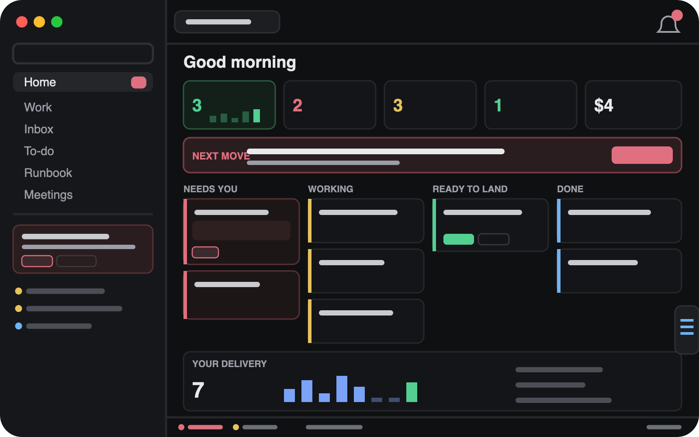

# lstack-herdr

cockpit's window for the Herdr app with three things added. On the left, cockpit's sidebar: the pinned apps, then the
spaces with their agents. Along the top, the tabs and a bell that counts the agents waiting for you. In the middle,
Home's agent cards in four columns by whose move it is, or the work view of panes. On the right, a side panel with
cockpit's Documents, Review, Runbook, Files and Changes tabs and a new one, 에이전트 호출 트리 (⌃⌘6): every OMP agent's
task subagents as a live tree, with their tasks, results and transcripts. The Files tab (⌃⌘4) edits files instead of
previewing them, Home's cards list each agent's running subagents, and a terminal that lost its program to a reboot
gets its Claude Code, Codex or OMP session back. A status bar runs under the middle, and a prompt-queue drawer peeks
out of the right edge. The added panels are labelled in Korean.



## What you see

Colors come from the Herdr theme. The layout names `canvas`, `chrome`, `background`, `border` and `solid`; the views
use cockpit's tokens on the same theme: `muted`, `mutedFg`, `dim`, `ring`, the agent statuses `working`, `blocked`,
`done` and `idle`, and `destructive` (the theme's `ansi1`). Type follows cockpit's scale: 11, 12, 13, 15 and 18 px.
Radii: 4, 6, 8 and 12 px, 10 px on the cards.

The window has no title bar; macOS's window buttons sit at 12, 16. The background is `canvas`, dividers are 1 px
`border`, and terminals are padded 14 × 12.

- **Sidebar**, left, full height: 268 px (44 to 480), `chrome`, not resizable by its edge.
  - Brand, 46 px: Herdr's `workspace-chrome`; dragging it moves the window.
  - cockpit's sidebar: fills the rest, at least 120 px.
  - Footer, 69 px: `workspace-chrome` as a footer.
- **Top bar**, 42 px: Herdr's `tabs` (drags the window), then cockpit's bell, 52 px.
- **Center**, a stack padded 8 px. A card here is radius 10, a 1 px `border` frame, `background` and shadow `sm`.
  - Home, shown first: cockpit's board. Beside it, 8 px apart, a focused agent's card, hidden until opened: 600 px
    (360 to 1100), a 34 px agent head over the agent's terminal.
  - Work: the active tab's panes (radius 10, a 1 px `border` frame, `solid` when focused, 8 px apart, each under a
    30 px header always shown), or the focused agent's card (34 px head over its terminal). Beside it, 8 px apart, the
    side panel.
  - Inbox, Runbook, To-do, Meetings, Monitor, Routines and Mail: cockpit's apps, one card each.
- **Side panel**, hidden until opened: 420 px (280 to 900), a card. The tab body on the left, a 44 px activity rail on
  the right with one button per tab: Documents, Review, Runbook, Files, Changes, then 에이전트 호출 트리 (icon
  `workflow`, ⌃⌘6).
- **Status bar**, 34 px, under the center.
- **Queue drawer**: floats on the right edge, centered, 44 px peeking out.

The **call tree tab**:

- Header: a 24 px square with the `workflow` icon in `ring` on a 14% `ring` tint, the title and a subtitle, and the
  view switch 목록 / 실행. Under it, a 40 px bar: scope tabs 포커스 / 스페이스 and 완료 숨기기.
- 목록: rows 42 px high, two lines. The first line, 18 px: a chevron when the node has children, the status mark, the
  name at 13 px (semibold for a root, medium below), the agent type at 12 px `dim`, a `하위 N` pill when folded, 실패
  or 중단 in `destructive`, and the duration in mono. The second line, 16 px, indented 40 px: the task's first line at
  12 px `mutedFg`. Each level indents 16 px (14 px when the panel is under 300 px wide) up to depth 4, with 1 px
  `border` guides. Finished rows are at 50% opacity. Roots are 13 px apart with a 1 px rule between them. An open row
  sits on `muted`, radius 8, with its detail under it.
- Under 300 px wide, the view switch and 완료 숨기기 shrink to icons and the type moves to the second line.
- 실행: one run of one root as cards, stacked and indented by depth.
- 창으로 크게 보기: a window 85% × 90% of the app, the run as a top-down card tree.
- 기록 열기: a transcript window, 760 px wide and 80% of the app's height.

**Home cards** of agents with subagents get a box between the recap and the facts (radius 6, 1 px `border`, 4 px
padding): each running direct subagent as a 30 px row (mark, name at 12.5 px, type, `+N 하위` when it has its own
subagents, duration, chevron), then a 28 px line `완료 N · 실패 N · 그 밖 N` led by a 6 px dot: `done`, or
`destructive` when there are failures and none done. A failed subagent anywhere below puts a red `실패 N` badge with
`circle-x` in the card's header.

The **Files tab**: the focused pane's folder as a tree, 새 파일 and 새 폴더 in the header. A file opens as an editor
with 저장 in its header. Past the limits, the note `폴더당 500개 · 전체 5,000개까지만 표시합니다` ends the tree.

## How it behaves

**Statuses**, everywhere the tree draws a node:

| Status | Mark | Chip |
|---|---|---|
| working | a turning ring in `working` | 실행 중 |
| blocked | a dot in `blocked`, breathing between 35% and 100% every 1.2 s | 입력 대기 |
| done | a solid dot in `done` | 완료 |
| idle | an empty ring in `idle` | 유휴 |
| failed | `circle-x` in `destructive` | 실패 |
| aborted | `circle-stop` in `destructive` | 중단 |
| an `hc` terminal, not running | the `terminal` glyph in `mutedFg` | 터미널 |

A root whose statuses come from transcripts alone (no live records: OMP runs without the extension) gets the 추정
tag, 16 px high, 10.5 px text, outlined in `dim`, and its subagents' durations start with ≈.

**The tree**

- A click on a row opens its detail in place: status, exact duration and time span, the task, the shared 공통
  context (folded), the result, and 기록 열기 (a subagent) or 이동 (a terminal). A click on a root folds it. The
  chevron folds a node's children; depth 2 and below start folded.
- 이동 on a terminal without a pane peeks at it; on a root terminal it focuses the agent and shows the work view.
  Roots in other terminals get 이동 in 스페이스 scope.
- Selection, folds, view, scope, the shown run and the opened call are shared: the list, 실행, the window and Home
  move together.
- 실행 shows one run of one root: the user message that started it and everything until its final output. ‹ › step
  through the root's runs. A card is an agent: its status, its task's first line, its latest steps (a model call, then
  its tool's result) as bars inside its own lifetime, failed steps kept beyond the latest five, its cost and lifetime.
  A click on a card selects it, and a click on a step's row opens the call under it. In the window, esc closes the
  open call and then the window, tab moves between cards and rows, ⏎ selects and expands.
- The rail button's badge: the space's failures nobody has looked at, in `destructive`; else its running subagents,
  in `working`; else nothing. Failures count as seen once the tree has drawn them.
- When a subagent's live record turns failed or aborted, an error toast `하위 에이전트 실패: <name>` (or `중단`)
  shows its type and task for 10 s, once per subagent; a click opens the tree on it.
- What the tree shows comes from `lh-scan.mjs tree`. Every block of the layout keeps its own copy of that scan. The
  status bar's watcher, the tree tab while it shows, its window and Home while it shows tick every 3 s (an open
  transcript window every 5 s). A tick scans only when the roots or their live records changed since the last scan,
  else at most every 15 s while any subagent runs and every 60 s otherwise, one scan at a time. A view that just
  opened rescans if the last scan is more than 2 s old. A hidden tab reads nothing.
- 기록 열기 reads the subagent's transcript every 2 s, one read at a time: only what was appended since the last read,
  whole entries only. A read returns the task (up to 16,000 characters) and at most the latest 300 other entries: an
  agent message or error up to 6,000 characters, a later user message up to 2,000, a tool result up to 400, a tool
  call's one-line argument up to 300. The window keeps the task apart from its latest 200 entries. It follows the end
  unless you scroll up (최신으로 brings it back); a finished transcript opens at the top. There is no input.

**Home**

- An agent blocked on you stays Needs you. Otherwise, the agent or any subagent below it running makes it Working.
  Otherwise cockpit's own rule decides.
- An idle agent whose subagents run shows `하위 12m`, the time since the first of them started, as its timer.
- A failed subagent leaves the stage alone and adds the red badge.
- A click on a subagent row opens its prompt in place, its first Markdown heading in semibold, with 트리에서 보기, which
  focuses the agent and opens the work view, the tree tab and that node.

**Files**

- The tree loads a folder when it opens, marks files from `git status`, watches the folder and rereads it every 10 s.
- A click opens the file in the editor, highlighted by the grammar its extension or name selects. ⌘S or 저장 saves.
  When the file changed on disk since it was read, Herdr refuses the save and the notice offers 다시 불러오기 or
  덮어쓰기. A file rewritten by something else reloads by itself while it has no unsaved edits.
- While a file has unsaved edits, the panel stays on it instead of following the focused pane, and going back to the
  tree asks first.
- Read-only: a file in a space on another machine, one without write permission, one over 400,000 characters (shown
  cut short).
- 새 파일 and 새 폴더 in the header (the top level) and on a folder's row (inside it); 이름 변경 and 삭제 on every row
  while the pointer is on it, and in the open file's header. A name is typed in place, ⏎ makes it and esc cancels. It
  is refused, with the reason, when empty, `.` or `..`, holding a `/`, or taken in its folder.
- A delete stops at a confirm whose default is 취소: ⏎ and esc cancel, only its own button deletes. The confirm says
  whether the item goes to the Trash or for good and, for a folder, how many entries go with it.

**Session restore**, every 4 s, for every live terminal Herdr keeps as a pane:

- Claude Code, Codex or OMP in the foreground: the label `lstack-herdr.resume` records `{tool, session, argv, cwd,
  pid}`. It is checked again when the tool's turn or status changes, and at least every 60 s.
- Back at a shell prompt with a new shell process: the label moves to the new process first (one attempt per loss),
  then the resume command is typed into the shell, after `cd <cwd> &&` when the folder differs.
  - Claude Code: `<argv> --resume <session id>`.
  - Codex: `codex resume <flags> <session id>`.
  - OMP: `<argv> --resume <session file>`.
- The tool gone from the same shell for 60 s: the label goes.
- Toasts: `이전 세션 N개를 복원했습니다` (success, 8 s) and `세션 복원 오류` (error, 10 s, once per error).

**Sync**

- Every 60 s the status bar compares `cockpit.json`'s version with the fork's stamp. When they differ, `cockpit <v>
  updated · Sync` shows for 30 s, once per version. Its click runs Sync.
- Sync shows `lstack-herdr: sync 중…` (2.5 s), then, when it changed nothing, `lstack-herdr: 이미 최신입니다` (5 s;
  30 s with warnings). A failure while checking or building writes nothing: `lstack-herdr sync 실패 · 이전 포크 유지`
  (30 s) with the reason. A failure while writing can leave the outputs written before it replaced:
  `lstack-herdr sync 실패 · 일부만 바뀜, Sync를 다시 실행하세요` (30 s), its body `이미 바뀐 것: …` and the reason.
  A Sync that rebuilt the fork reloads it, and the reloaded copy announces `lstack-herdr: cockpit <v>로 다시
  만들었습니다` with the advice to restart Herdr and the stamp's warnings (30 s).
- `mod.open lstack-herdr` shows the source view: the cockpit version, the version the fork was built from, the
  warnings saved in the stamp, and the buttons Sync and `lstack-herdr 레이아웃으로`. Sync also runs from the toast;
  the palette does not list it.

**Keys**: cockpit's 24 in `layout:lstack-herdr`, renamed to `lstack-herdr-cockpit.`, plus `ctrl-cmd-6` →
`lstack-herdr-cockpit.panel:tree`. A side panel key opens its tab, or closes the panel when that tab already shows.

## Built from

**The layout**, `layouts/lstack-herdr.json` (`fork` = mod `lstack-herdr-cockpit`):

```text
root  row · titlebar none · traffic_lights [12, 16] · background canvas · terminal_padding [14, 12] · divider 1 border
│     preview layouts/lstack-herdr.svg
│     floating: queue  fork {app: queue} · edge right · align center · peek 44
├─ sidebar  column · 268 px · min 44 · max 480 · background chrome · resizable false
│  ├─ brand            block · 46 px · window_drag       workspace-chrome
│  ├─ cockpit-sidebar  block · weight 1 · min 120         fork {app: sidebar}
│  └─ sidebar-footer   block · 69 px                     workspace-chrome {footer: true}
└─ main-area  column · resizable false
   ├─ topbar  row · 42 px · resizable false
   │  ├─ tabs  block · window_drag                         tabs
   │  └─ bell  block · 52 px · window_drag                 fork {app: bell}
   ├─ center  stack · active home · padding 8
   │  ├─ home  row · gap 8
   │  │  ├─ home-board  block · card                       fork {app: home}
   │  │  └─ home-agent  column · hidden · 600 px · min 360 · max 1100 · padding [0, 0]
   │  │     └─ home-agent-card  column · card · resizable false
   │  │        ├─ home-agent-head  block · 34 px          fork {app: agent-head, place: home}
   │  │        └─ home-agent-term  block                  {agent: focused}
   │  ├─ work  row · padding 0 · gap 8
   │  │  ├─ view  stack · active main
   │  │  │  ├─ main   block  {tab: active, pane: {gap 8, radius 10, background, lone, border 1 border,
   │  │  │  │                 focus 1 solid, header: fork {app: pane} · 30 px · top · reveal always}}
   │  │  │  └─ agent  column · card · resizable false
   │  │  │     ├─ agent-head  block · 34 px               fork {app: agent-head, place: work}
   │  │  │     └─ agent-term  block                       {agent: focused}
   │  │  └─ panel  row · hidden · 420 px · min 280 · max 900 · card · resizable false
   │  │     ├─ panel-body  stack · active show
   │  │     │  ├─ show           block                    fork {app: show}
   │  │     │  ├─ review         block                    fork {app: review}
   │  │     │  ├─ runbook-panel  block                    fork {app: runbook, scope: focused}
   │  │     │  ├─ files          block                    fork {app: files}
   │  │     │  ├─ changes        block                    changes
   │  │     │  └─ tree           block                    fork {app: tree}
   │  │     └─ activity  block · 44 px                     fork {app: activity, stack: panel-body}
   │  └─ inbox, runbook, todo, meetings, monitor, routines, mail
   │                     block · card each                 fork {app: <its id>}
   └─ status  block · 34 px                                fork {app: status}

card = radius 10 · border 1 border · background background · shadow sm
```

**The mods**

- `lstack-herdr-cockpit`: generated, never edited. cockpit's mod with its views by `props.app`, plus `tree`, `files`
  and two window views opened with `openOverlay`: `tree-window` (the run window) and `transcript`.
- `lstack-herdr`: the hand-written source (`mod.json`: `place: "none"`, title `lstack-herdr (source)`).
  - `main.js`: the source view.
  - `sync.mjs`: the generator.
  - `hooks.mjs`: the 17 hooks.
  - `components/`: `lh-files.js`, `lh-files-ops.js`, `lh-home.js`, `lh-resume.js`, `lh-resume-tools.js`, `lh-run.js`,
    `lh-scan.mjs`, `lh-transcript.js`, `lh-tree-data.js`, `lh-tree-view.js`, `lh-ui.js`, `lh-watch.js`, and
    `icons/folder-plus.svg`.
  - `omp/lstack-herdr-tree.ts`: the OMP extension.
- Herdr's shipped mods: `workspace-chrome`, `tabs`, `changes`.

**The generator**, `node mods/lstack-herdr/sync.mjs [--check] [--home <herdr-app home>] [--json]`, from cockpit 0.38.5
as `cockpit app install` leaves it:

1. Reads `mods/cockpit/`. Skips dotfiles, `*.error`, `gpui-kit.d.ts` and `jsconfig.json`.
2. Mod-name rewrite in every `.js` file: `mods/cockpit/` paths, `cockpit.<name>` string literals (commands and shared
   keys; not `cockpit.json` or `cockpit.svg`), `mod: "cockpit"` and `.mod === "cockpit"` become
   `lstack-herdr-cockpit`. Each of the four kinds must be found at least once, and no `mod: "cockpit"` or
   `cockpit.<name>` string literal may survive.
3. The 17 hooks, each an exact anchor and `before`, `after` or `replace`:
   - `main.js` (2): imports `LhTree`, `LhTreeWindow`, `LhTranscript`, `LhFiles` after `import Mail from "./mail.js";`;
     `VIEWS` gains `tree`, `tree-window`, `transcript`, `files`.
   - `status.js` (4): `PANELS` gains `tree: "tree"`; imports `lhWatch`, `lhCommand`, `lhResume`; `init` starts
     `lhWatch(cx)` and `lhResume(cx)`; `command()` tries `lhCommand` first.
   - `activity.js` (3): the item `{ name: "tree", icon: "workflow", label: "에이전트 호출 트리", key: "⌃⌘6" }` after
     Changes; imports `lhTreeBadge`; the tree's badge comes from `lhTreeBadge()`.
   - `fleet.js` (2): imports `lhStage`; `agent.stage = lhStage(agent, stageOf(agent))`.
   - `home.js` (6): imports `lhCardKids`, `lhFailBadge`, `lhTimer`, `lhHomeWatch`; `lhHomeWatch(cx)` in `init`; the
     card's `const timer` becomes `let timer`, then `lhTimer`; `lhFailBadge(card)` before the timer; `lhCardKids` after
     the recap.
4. The notice: every upstream `.js` file that step 2 or 3 changed gets one line at its top (after a `#!` line, if
   any), above cockpit's own first line:

   ```js
   // Modified by lstack-herdr (https://github.com/Lapis0875/herdr-lstack-layout): generated by mods/lstack-herdr/sync.mjs from cockpit <version>, cockpit's own mod name rewritten to lstack-herdr-cockpit[, lstack-herdr hooks applied].
   ```

   The bracketed part only where a hook applied; `<version>` is `cockpit.json`'s.
5. Copies `components/` into the fork's root and sets `mod.json`'s title to `Cockpit (lstack-herdr)`.
6. The layout from `layouts/cockpit.json`: every `mod: "cockpit"` names the fork; the `files` block, Herdr's `files`
   mod upstream, becomes `fork {app: files}`; a `tree` block is appended to `panel-body`; `preview` names
   `layouts/lstack-herdr.svg`. Floating blocks the current `layouts/lstack-herdr.json` has and cockpit's does not (by
   `id`) go back on the node that held them.
7. `layouts/cockpit.svg` is copied to `layouts/lstack-herdr.svg` unchanged.
8. `keys.json`: `layout:cockpit` → `layout:lstack-herdr`, `cockpit.` → `lstack-herdr-cockpit.`, plus `ctrl-cmd-6`.
9. The stamp `.lstack-sync.json`: `generator`, `cockpit` (from `cockpit.json`), `upstream` and `source` (16-hex
   hashes of the inputs; `omp/` is left out), `hooks: 17`, and `warnings`, the warnings of steps 6 and 8 exactly as
   the command line prints them. It is serialized after the layout and keys for that reason.
10. Compares everything with what is on disk and writes only what changed. `--check` writes nothing and exits 2 when
    something would change. A failure while checking or building (an anchor, a rewrite count, a file that is not
    JSON) writes nothing and exits 1 with `lstack-herdr: sync failed, previous output kept: <reason>`. Then, in this
    order: the fork, staged in `~/.cache/lstack-herdr/` and swapped in with one rename (the old fork is put back if
    that fails); `layouts/lstack-herdr.svg`, `layouts/lstack-herdr.json` and `keys.json`, each written to a sibling
    temp file and renamed over. A failure while writing exits 1 with `lstack-herdr: sync failed while writing, run it
    again; already replaced: …` (or `nothing was replaced`); `--json` reports `phase: "write"` and `written`.

**Herdr functions**: `terminals`, `focused`, `agents`, `spaces`, `panes`, `layout`, `shared`, `setShared`, `exec`,
`hc`, `notify`, `run`, `openOverlay`, `closeOverlay`, `props`, `readTextFile`, `writeTextFile`, `watchFolder`,
`theme`, `settings`, `appHome`, `home`, `window`, `checking`. **Commands**: `layout.select`, `layout.show`,
`agent.focus`, `terminal.peek`, `layout.switch`, and the fork's own `lstack-herdr-cockpit.tree:open:<root>:<id>`,
`.tree:view:<list|run>`, `.tree:window`, `.tree:window:close`, `.tree:run:<root>:<index|latest>`,
`.tree:call:<root>:<run>:<card>:<row>`, `.tree:call:close`, `.tree:log:<root>:<id>`, `.sync` and `.files:*`.

**Programs**, derived from every `exec` and `hc` call in `main.js` and `components/`, the `sh -c` scripts they run
(built-ins left out) and `lh-scan.mjs`'s child processes; `sync.mjs` and the OMP extension run none:

- `node`: `sync.mjs`; `lh-scan.mjs` with `tree`, `detail`, `run`, `call` and `transcript`, which runs `ps -o tty= -p`
  and `ps -t <tty> -o comm=`.
- `sh -c`, Files: the listing and new file (shell only); new folder `mkdir`; rename `mkdir`, `rmdir`, `mv -T` (where
  `mv --version` works) or `perl`, `mv`, `link`, `readlink`, `ln -s`, `rm`; delete `/usr/bin/trash -s` or `rm`;
  counting a folder's entries `find`, `head`, `wc`.
- `sh -c`, the session lookup: `pgrep`, `readlink` on `/proc/<pid>/fd` or `lsof` with `sed`, then `grep` and `head`
  (Codex, and OMP without a `_session` record); `sed` and `head` (Claude Code).
- `git rev-parse --show-toplevel` and `git --no-optional-locks status --porcelain=v1`.
- `test -w`, `test -x /usr/bin/trash`, and `powershell` for a Windows folder listing.
- `hc label` and `hc send`.

**Inputs outside the mod**: `~/.omp/agent/terminal-sessions/<tty>` (OMP's breadcrumb: cwd, session path), OMP
session transcripts, `~/.claude/sessions/<pid>.json` and `~/.claude/projects/*/<id>.jsonl`, the rollout file a Codex
process holds open, `cockpit.json`. Caches: `~/.cache/lstack-herdr/scan-cache.json` and `run-cache.json`.

**The OMP extension** reports over OSC 7501 on the terminal OMP draws to, only when `HC_TERMINAL_ID` is set and stdout
is a TTY. One record per subagent: `id` its transcript path under the root session without `.jsonl`; `state`
started → working, completed → done, failed or aborted → error; `title` `<agent type> · <name>`, plus ` · failed` or
` · aborted`; `msg` the task's first meaningful line, at most 2048 bytes. The reserved `_session` record (idle) holds
the root session's `.jsonl` path; it is sent at start, on every session switch and every 64 subagent reports.

**Art**: cockpit's icons, plus `folder-plus.svg` (Lucide's, at stroke 1.75 like cockpit's `folder.svg`). The preview
is cockpit's `cockpit.svg`.

## Watch out

- **Each anchor must appear exactly once** in its file after the rewrite, so anchors read `lstack-herdr-cockpit`,
  never `cockpit`. A missing or repeated anchor fails the whole Sync before anything is written.
- **Upstream panels**: the hooks were written against `show`, `review`, `runbook-panel`, `files` and `changes`. A new
  one is kept and reported in `warnings`; the tree tab should stay last.
- **Restart Herdr after a Sync** that rebuilt the fork. Herdr's mod runtime never frees a reloaded block's module, so
  each rebuild adds about 25 MB until Herdr restarts.
- **Every block is its own copy** of the module, and Herdr hands shared state to every copy of every mod on each
  change. Keep shared state to ids and small numbers; the scan's results and node details stay in the copy that asked.
- **The live tree is OMP-only.** Without the extension, statuses are 추정, read from transcripts.
- **255 records a terminal**: herdr-core drops the least recently updated record past that, hence `_session` every
  64 reports.
- **Fixed names**: the source folder `lstack-herdr`, the fork `lstack-herdr-cockpit` and the layout `lstack-herdr`
  are constants in `sync.mjs`, `lh-tree-data.js` and `lh-watch.js`. Two copies cannot share a Herdr app home.
- **Delete**: `/usr/bin/trash` (macOS 15) only on the Mac Herdr runs on; anywhere else `rm`, gone for good.
- **Session restore relies on keep recovery**: herdr-core keeps a terminal's address and labels when it gives it a
  fresh shell, never its program. The label moves to the new shell before anything is typed, so a failed attempt is
  not repeated. Flags are parsed from the `--help` of Claude Code 2.1.311, Codex 0.167.0 and OMP 18.20.3.
- **Staging**: Sync stages the fork under `~/.cache/lstack-herdr/` and swaps it in with renames, so that folder and
  the Herdr app's home must be on the same volume. `--home` moves the target, not the staging folder.
- **Herdr's own files**: Herdr writes `gpui-kit.d.ts` and `jsconfig.json` into mod folders; Sync carries the fork's
  copies over and keeps them out of the stamp's hashes.
- **The `files` block**: if cockpit's layout stops showing Herdr's `files` mod there, Sync leaves it as cockpit has
  it, without the editor, and warns.
- **The notice line** goes above cockpit's first line in every `.js` file the generator changes. The Apache License
  2.0 §4(b) requires it for `code.js` (from herdr-editor-layout); keep it in any change to the generator.
- **Warnings belong in the stamp**: build the layout and keys before serializing `.lstack-sync.json`. The source view
  and the rebuild toast read the stamp, so warnings added after it would show only on the command line.
- **Writes are not all-or-nothing**: only checking and building come before the first write. The fork swaps in with
  one rename and each file is renamed over, but a failure between outputs (a full disk, a folder it cannot write)
  leaves the earlier ones replaced. The message names them; Sync again once the cause is fixed.
- **The palette** does not list `lstack-herdr-cockpit.sync`; Sync runs from the toast, the source view and the
  command line.
- **herdr-relay**: no built-in profile names `lstack-herdr-cockpit`, so on devices its `exec`, `hc` and network calls
  are refused until you write one.

## Done when

1. `node ~/.config/herdr-app/mods/lstack-herdr/sync.mjs --check` exits 0 after a Sync, and a second Sync prints
   `lstack-herdr: already up to date`.
2. `jq -c '{cockpit, hooks, warnings}' ~/.config/herdr-app/mods/lstack-herdr-cockpit/.lstack-sync.json` prints
   `{"cockpit":"0.38.5","hooks":17,"warnings":[]}`.
3. `head -1 ~/.config/herdr-app/mods/lstack-herdr-cockpit/code.js` starts with `// Modified by lstack-herdr`.
4. In `~/.config/herdr-app/layouts/lstack-herdr.json`:
   - `jq -c '[.floating[].id]'` prints `["queue"]` (plus `"herdr-relay-mirror"` if you added the mirror).
   - `jq -c '.. | objects | select(.id? == "panel-body") | [.children[].id]'` prints
     `["show","review","runbook-panel","files","changes","tree"]`.
   - `jq -c '[.. | objects | .mod? // empty] | unique'` prints
     `["changes","lstack-herdr-cockpit","tabs","workspace-chrome"]` (plus `"herdr-relay-mirror"` with the mirror).
5. `jq '.["layout:lstack-herdr"] | length, .["ctrl-cmd-6"], all(.[]; startswith("lstack-herdr-cockpit."))'
   ~/.config/herdr-app/keys.json` prints `25`, `"lstack-herdr-cockpit.panel:tree"` and `true`.
6. `herdr-app check` passes on `mods/lstack-herdr-cockpit` and `mods/lstack-herdr`.
7. A missing anchor fails safely:

   ```sh
   T=$(mktemp -d) && mkdir "$T/mods" && cp -R ~/.config/herdr-app/mods/cockpit "$T/mods/"
   sed -i '' '/^import Mail from ".\/mail.js";$/d' "$T/mods/cockpit/main.js"
   node ~/.config/herdr-app/mods/lstack-herdr/sync.mjs --home "$T" --check
   ```

   exits 1 with `anchor not found in main.js`, and nothing under `$T` changed.
8. In the app: ⌃⌘6 opens the tree tab, last in the side panel, its rail button after Changes; an OMP agent's task
   subagents appear under it while they run; ⌃⌘4 opens a file in the editor and ⌘S saves it.
